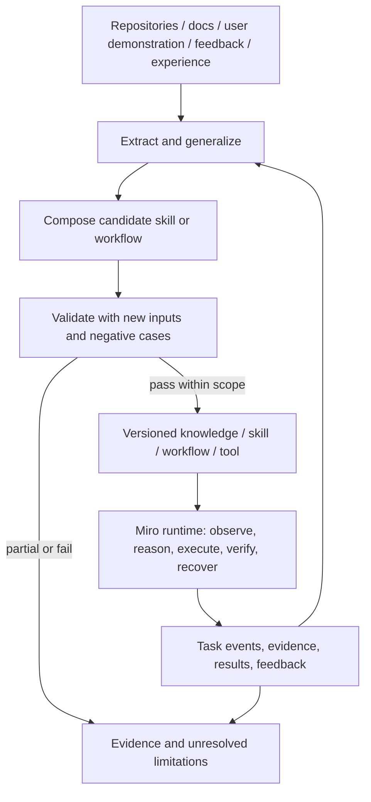

# MIRO — Research Consolidation v1

**Ngày:** 26/11/2026  
**Trạng thái:** Tổng hợp nghiên cứu / ứng viên kỹ thuật — chưa phê duyệt tích hợp  
**Phạm vi:** 8 repository, 9 báo cáo mới nhất và các lập luận đã trao đổi giữa hai AI.  
**Mục đích:** Một nguồn tham chiếu để chuyển từ khám phá ý tưởng sang đối chiếu source và kiểm chứng khả năng tái sử dụng.

## 1. Định hướng chung

Miro là AI Operating Workspace độc lập, local-first, có thể kết nối từ xa theo quyền được cấp. Người dùng có thể thao tác thủ công, giao nhiệm vụ bằng ngôn ngữ tự nhiên, sử dụng workflow đã biết hoặc tự động hóa theo lịch/sự kiện. Coding Agent là công cụ phát triển Miro, không phải điều kiện bắt buộc để Miro chạy.

Miro cần tăng trưởng cả về năng lực thực thi lẫn khả năng phối hợp, tái sử dụng và tích lũy kinh nghiệm. LLM không nhất thiết phải được nâng cấp thì hệ thống mới cải thiện được; skills, workflows, dữ liệu, bộ kiểm thử và phương pháp thực hiện đã kiểm chứng cũng là tài sản tăng trưởng. Đây là định hướng, không phải khả năng đã triển khai.

**Nguyên tắc:** khai thác tối đa giá trị, tối thiểu hóa sự phức tạp, kiểm chứng trước khi tích hợp, tích lũy năng lực qua sử dụng.

- Không giới hạn repository vào công dụng gốc; một cơ chế có thể phục vụ nhiều nghiệp vụ và nhiều cơ chế có thể tạo thành năng lực mới.
- Không loại bỏ giải pháp vì khác ngôn ngữ. Ưu tiên API thư viện, CLI/JSON, MCP, IPC/HTTP, FFI theo nhu cầu thực tế; chỉ fork hoặc port khi có lý do.
- Tái sử dụng cả executable, module, thuật toán, schema, protocol, state machine, prompts, skills, tests, fixtures, evals, UI interaction, packaging, runbooks và bài học từ lỗi.
- Kiểm kê Miro trước khi thêm code: reuse → integrate/adapt → build. Một owner cho mỗi trách nhiệm, không dựng thêm Gateway, scheduler, task store, evidence store cạnh tranh.
- Tách nghiên cứu (có thể rộng) khỏi production (chọn lọc, bằng chứng, quyền hạn, chi phí bảo trì). Không bắt buộc đưa mọi tài sản vào runtime; DEFER/REJECT có lý do là quyết định hợp lệ.
- Không coi output schema đúng, test mock xanh hoặc trace có hash là bằng chứng nghiệp vụ thành công. Không coi AI tự đánh giá là kiểm chứng độc lập.

## 2. Bảo toàn trạng thái phát triển

Theo các báo cáo đã trao đổi, không phải xác minh repository trực tiếp:

| Mốc | Trạng thái cần giữ |
|---|---|
| Slice 01 Browser Bridge | Đạt trong phạm vi đã nghiệm thu |
| Slice 01B Persistent Connection | Đã nghiệm thu pairing/reconnect; còn regression cold-restart cần theo dõi |
| Slice 02A / 02B Browser Observation / Interaction | Đạt theo báo cáo; giữ production route, Profile/Tab binding, REA-MẮT |
| Slice 03 Media Intelligence — `9b33700`, chưa push | Level 1–2 accepted; Level 3–4 partial; Level 5 blocked. Backend 458 passed + 2 skipped; Bridge 89 passed; C1 4/4. 2/5 video decompose đủ hình, 3 audio-only probe; chưa đủ kết luận pipeline phân tích đầy đủ 5 video. STT Sherpa/diarization blocked, VLM denied theo policy. |
| Project Context Grounding | Audit đã báo hoàn thành và commit; giải pháp và cold-start acceptance chưa được xác nhận trong tài liệu này. |
| Slice 04 — `ec94b0e` | Báo cáo ở trao đổi khác: A–E đạt trong phạm vi thử, 04F 3 đạt/3 partial; one-click full app chưa đạt; full regression sau commit chưa được báo chạy lại. |
| 8 repository | Nghiên cứu, chưa quyết định cài đặt/tích hợp hàng loạt. |

**HEAD hiện tại chưa xác minh.** `9b33700` là baseline báo cáo Slice 03; `ec94b0e` là mốc báo cáo Slice 04 mới hơn, không mặc định là HEAD đang làm việc. Trước source mapping phải đọc branch/HEAD/working tree và trạng thái nghiệm thu mới nhất, không reset hoặc ghi đè công việc đang làm. Không tự mở lại Slice đã accepted chỉ vì có ý tưởng mới. Những vấn đề còn tồn đọng không được biến mất khi chuyển giai đoạn nghiên cứu.

## 3. Mô hình tư duy hợp nhất (không phải danh sách service)

### 3.1 Từ thực thi đến tích lũy

Execution Agent mang lại kết quả hiện tại. Capability-Accumulating Agent còn tạo ra ứng viên năng lực tái sử dụng được cho tương lai. Hai cụm từ là cách mô tả trong cuộc trao đổi, không phải phân loại chuẩn của ngành.

Phân biệt năm lớp thông tin: Raw History (đã làm gì), Evidence (bằng chứng), Experience (phương pháp và điều kiện có tác dụng), Candidate Skill (giả thuyết tổng quát hóa), Validated Capability (đã kiểm thử trên dữ liệu khác trong phạm vi rõ ràng). Đây là các mức trưởng thành tri thức, không phải trạng thái lifecycle bắt buộc của mọi Task. Một trace thành công không tự nâng lên skill đã kiểm chứng.

Vòng đời: Discover → Execute → Verify → Extract → Generalize → Validate → Reuse; khi dependency, quyền, môi trường, input class hoặc policy thay đổi thì đánh giá lại điều kiện và bằng chứng. Có thể hạ trạng thái, vô hiệu hóa phiên bản hoặc rollback workflow. Không tự sửa source, tự cấp quyền, tự cài dependency hoặc tự gửi dữ liệu cho provider.

### 3.2 Chọn phương pháp thực thi bằng ba chiều độc lập

| Chiều | Giá trị |
|---|---|
| Nguồn kết quả | Tái sử dụng Evidence còn hiệu lực / thực thi mới / kết hợp |
| Điều khiển | Deterministic / Hybrid / LLM exploratory |
| Độ quen thuộc | Đã kiểm chứng / biến thể mới / chưa từng gặp |

Parameterized workflow là một dạng có thể thuộc deterministic hoặc hybrid, không phải mức đối lập với deterministic. AI có thể khám phá cách làm mới, rút ra workflow có tham số, kiểm chứng và giảm số lần gọi LLM ở những lần sau. Nếu trạng thái thay đổi hoặc gặp ngoại lệ, re-observe rồi dùng phương pháp phù hợp. Không hy sinh chất lượng để giảm token.

Intent → required capability → lọc provider theo quyền, readiness, applicability và yêu cầu chất lượng → chọn chiến lược → execute → verify. Chỉ xếp hạng tốc độ/chi phí sau khi đáp ứng điều kiện cứng. Dừng khi policy denied, thiếu quyền hoặc nền tảng từ chối; fallback không được dùng để né hạn chế. Có thể trả partial với dữ liệu thiếu được nêu rõ.

### 3.3 Học cả giới hạn, dự đoán và thất bại

Ghi lại điều kiện áp dụng (môi trường, version, profile/target, dữ liệu, dependency, yêu cầu chất lượng, quyền), trạng thái phù hợp / không đáp ứng / chưa biết; không biến một kết quả riêng lẻ thành quy luật tổng quát. Lưu dự đoán hữu ích trước khi chạy (số record, phạm vi, chi phí, thời gian, rủi ro) rồi đối chiếu thực tế. Không biến dự đoán thành số liệu thật, không suy diễn nguyên nhân nếu chưa có Evidence.

Thất bại → chẩn đoán → phản chứng → xác minh cách xử lý → rút kinh nghiệm → regression fixture. Lỗi tạm thời có thời hạn đánh giá lại; policy DENIED không tự đổi thành READY. Thu thập phản hồi của người dùng với scope và nguồn gốc phù hợp, không tự biến một lựa chọn chủ quan thành quy luật chung.

## 4. Nguồn tham chiếu và mức bằng chứng

Tên báo cáo bên dưới là tên file người dùng cung cấp; đường dẫn source trong các bảng sau là **điểm truy xuất được báo cáo**, không phải file upstream đã được người viết tài liệu này mở trực tiếp. Mọi ứng dụng mở rộng, test và phương án tích hợp trong mục 5–8 là **CANDIDATE**, chưa nghiệm thu. Các báo cáo không thay thế source gốc và live verification.

| ID | Báo cáo tham chiếu | Phạm vi / giới hạn đáng nhớ |
|---|---|---|
| D | `agent-desktop(2).md` | Rust CLI/MCP/FFI; coverage đầu/cuối có điểm không đồng nhất; cần xác minh command/platform cụ thể trên Windows. |
| R | `agent-reach(2).md` | Python CLI 14 channels, không có TikTok channel trực tiếp trong danh sách; live acceptance được báo trên Darwin, không suy ra Windows. |
| M | `ai-manus(2).md` | Python + Vue/TS + sandbox; báo cáo tổng kết 100% nhưng nhóm Frontend mục 5.4 vẫn chưa mở từng dòng. |
| B | `browser-use(2).md` | Python LLM/DOM/agent; CDP coupling, telemetry/cloud cần kiểm soát; adapter thay CDP chưa được chứng minh. |
| O | `openclaw(1).md` | Node/TS multi-channel local Gateway, khảo sát entry/subsystem chính, chưa đọc sâu toàn repo. |
| E | `rea(1).md` | CLI/MCP reverse engineering; tập trung core và các provider quan trọng, không đồng nhất với REA-MẮT/REA Video của Miro. |
| T | `tiktok-api(1).md` | Python wrapper không chính thức, public read; không phải giải pháp upload hay login-required mặc định. |
| Q | `trend-opportunity-radar(1).md` | Skill/pipeline Python; candidate, TikTok/FB beta, onboarding và forward comparison còn pending theo báo cáo; structured import có tiềm năng. |
| I | `README(2).md` | Research index, không phải capability map. |
| H | `Pasted text(20261126-102851).txt`, `Pasted text (2)(7).txt`, `Pasted text.txt` và các phản hồi trong cuộc hội thoại | Tổng hợp ứng dụng chéo, learning, strategy, lifecycle, phản biện; các đề xuất không phải implementation. |

## 5. Technical Asset Registry — inventory ứng viên ban đầu

Bảng dưới là nguồn quản lý thống nhất để tra cứu theo repository, bài toán Miro và tổ hợp tài sản. Mỗi hàng có ID ổn định trong bản nghiên cứu này. Các mục nhỏ cùng trách nhiệm được nhóm để tránh tạo module giả tạo. Cột phương án là giả thuyết ưu tiên, chưa phải quyết định. Source mapping sẽ bổ sung commit/hash, file/hàm chính xác, dependency graph và module Miro thực tế.

### D — agent-desktop (Rust)

| ID | Tài sản / điểm truy xuất báo cáo | Ứng dụng trực tiếp và chéo | Hướng khai thác / proof cần có |
|---|---|---|---|
| D01 | CLI JSON, dispatch, PlatformAdapter, MCP; §1, §3.2, §5 | Desktop tools, Windows apps, Live Workspace | CLI adapter trước FFI; snapshot thật, kết quả schema hợp lệ, không phụ thuộc IDE |
| D02 | `ref_action/mod.rs`, `actions/delivery_semantics.rs`, `post_action.rs`; §2.2–2.3 | Publishing, API mutation, file/media edit, workflow, browser | Contract/algorithm; mất kết nối sau effect không tự retry; phân biệt verified effect với application commit |
| D03 | `actionability/evaluate.rs`, gates, stability sampler; §2.4 | Browser element, clip/track, document node, workflow node | Port/compare; target sai, hidden, disabled hoặc stale phải bị chặn trước effect |
| D04 | `refs/`, `snapshot/`, `locator/`, capture proof, qualified refs; §3 | Observation binding, resource identity, locator recovery | Contract; reference cũ không trỏ nhầm object mới; re-resolve phải xác minh danh tính |
| D05 | Window/process identity, input policy, interaction lease; §4–5 | Profile/process binding bổ trợ, human takeover, resource contention | Compare; OS process identity không tự chứng minh Chrome Profile; takeover phải đợi ack |
| D06 | Screenshot, cursor overlay, visual debug, trace/session; §4, §7 | Live Workspace, hướng dẫn thao tác, replay, audit | Adapter/UX port; ảnh và action đúng session, redaction, không log secret |
| D07 | Batch execution, wait primitives, command policy, diagnostics, conformance tests; §1–2, §7 | Deterministic workflow, bounded execution, doctor, acceptance | Reuse/port/tests; timeout, cancellation, partial batch, không retry side effect không rõ |

### R — agent-reach (Python)

| ID | Tài sản / điểm truy xuất báo cáo | Ứng dụng trực tiếp và chéo | Hướng khai thác / proof cần có |
|---|---|---|---|
| R01 | Channel/backend registry, `runtime/dispatch.py`, `runtime/result.py`; §Entry, §Channels | Internet Research, model/media/tool selection | Adapt; provider phải đáp ứng cùng intent contract, không bịa TikTok channel |
| R02 | Doctor, capability check, backend fingerprint, state ledger; §Entry, §Phụ lục | Runtime readiness, project preflight, dependency inventory, self-awareness kỹ thuật | Compare/extract; phân biệt installed, ready, partial, denied, broken, regressed |
| R03 | Ordered fallback, cooldown, query slots, final error codes; `runtime/dispatch.py` | Điều phối provider, tài nguyên nhiều agent, scheduler | Port; quyền/rate-limit/login denial không kích hoạt đường vòng; tôn trọng budget |
| R04 | `transcribe.py`, yt-dlp/FFmpeg, chunk/budget; §Entry | Media Intelligence, audio research | Compare REA Video trước; local/cloud đúng policy, không tự gửi audio hay cấp API key; thử fixtures được phép |
| R05 | Browser/session management, configuration, install ledger, update/rollback; §Browser, §Entry | Persistent connection, quản lý optional dependency, doctor/packaging | Learn/adapt chọn lọc; không copy cookie/Profile, không dùng dedicated browser/CDP ngoài policy |
| R06 | `scripts/record_release_acceptance.py`, `check_release_acceptance.py`, wheel gate; §Phụ lục | Live acceptance, regression, dependency update | Test/port; evidence gắn source/environment/method và hết hiệu lực đúng điều kiện |

### M — ai-manus (Python/Vue/TS)

| ID | Tài sản / điểm truy xuất báo cáo | Ứng dụng trực tiếp và chéo | Hướng khai thác / proof cần có |
|---|---|---|---|
| M01 | `domain/services/agents/base.py`, `manus.py`, `execution.py`, `flows/plan_act.py`; §1.4 | Agent reasoning, planning, replan, research, production | Compare/extract; kết quả thật, giữ failure, step limits, không cấp generic shell |
| M02 | `domain/services/tools/base.py`, `skill.py`, `mcp.py`, skill loader; §1.2–1.3 | Tool/skill discovery, structured output, project grounding | Reuse/port; task-specific skill, schema validation không đồng nghĩa correctness; host enforcement cho Dev Agent riêng |
| M03 | `agent_task_runner.py`, WaitEvent, PlanAct resume; §1.4 | Task lifecycle, approval, chờ render/download/external events | Compare; restart và resume không lặp side effect; cancel phải có trạng thái thật |
| M04 | File Diff, ToolContent, Task Events; §1.4 | Audit, versioning, work memory, review tài liệu/kịch bản | Adapt; trace được lưu đúng scope; diff không phải tự động rollback |
| M05 | ChatPage, ComputerPanel, PlanPanel, ToolUse, timeline scrub/follow, FilePreviewer, useAgentEvents; §5 | Chat, Live Workspace, progress, task replay, artifact preview | Port UX/event semantics sang frontend hiện có; real event, reconnect/reconcile, FAILED không thành COMPLETED |
| M06 | Sandbox, mockserver, tests/evals; §3–4, §7 | Isolated execution, negative controls, simulated E2E | Test/learn; sandbox riêng cho thao tác rủi ro nếu duyệt; mock không thay live; auth/CORS/VNC issues không nhập nguyên |

### B — browser-use (Python)

| ID | Tài sản / điểm truy xuất báo cáo | Ứng dụng trực tiếp và chéo | Hướng khai thác / proof cần có |
|---|---|---|---|
| B01 | `agent/service.py` step/run, `agent/views.py` AgentOutput/ActionResult; §1 | General browser intelligence, agent loop ở desktop/media/document | Compare/port; Observe–Decide–Act–Verify qua Gateway, không nhập CDP transport |
| B02 | Dynamic action models, domain-filtered registry, `tools/service.py`; §1, §3 | Context-aware tool selection, least privilege, skill routing | Contract/algorithm; tool schema chỉ hiện option hợp lệ nhưng Gateway vẫn enforce |
| B03 | DOM service/serializer, AX, visibility/paint order, interactive index; §3 | REA-MẮT tổng quát, compact UI observation | Adapt vào collector được phép, không bỏ collector chuyên biệt; test iframe/stale/hidden/secret |
| B04 | `multi_act`, terminates_sequence, URL/focus guard; §1 | Browser, media timeline, document, workflow state | Port/compare; state/version change ngắt chuỗi; URL không đổi vẫn có thể stale DOM |
| B05 | Loop detector, exploration/replan nudges, budgets/timeouts; §1 | Agent reliability, research dedupe, sửa lỗi, sáng tạo lặp | Extract; đo progress thực, thoát loop, không dừng nhầm công việc hợp lệ |
| B06 | `AgentHistoryList`, `variable_detector.py`, rerun, history GIF; §1 | Workflow extraction, parameterization, demonstration, replay tests | Explore/port; workflow candidate qua inputs mới, không replay tọa độ/ID/secret mù quáng |
| B07 | `message_manager`, model abstraction, token usage, judge; §1, §4 | Context compaction, model selection, strategy metrics, output evaluation | Reuse/compare; giữ constraints/unknowns khi compact; judge không thay Evidence; telemetry/cloud opt-in theo policy |

### O — OpenClaw (Node.js/TypeScript)

| ID | Tài sản / điểm truy xuất báo cáo | Ứng dụng trực tiếp và chéo | Hướng khai thác / proof cần có |
|---|---|---|---|
| O01 | `src/gateway/server.ts`, launcher/daemon, shutdown; §1, §5 | Standalone lifecycle, restart, service supervision | Compare sâu; one-click Miro, không dựng owner/gateway thứ hai mặc định |
| O02 | `src/cron/service.ts`, types, job lifecycle; §4 | Scheduler, delayed/event jobs, restart recovery | Compare/port nếu phù hợp; time zone, missed jobs, duplicate dispatch, cancel, reboot |
| O03 | `src/plugin-sdk`, capability ladder, manifests; §3 | Registry, extension boundary, skill/tool/provider/channel | Learn/contract; capability ở edge, one owner, không ép xây plugin framework mới |
| O04 | context-engine, memory-host-sdk, namespaces, prompt-prefix stability; §4 | Project memory, feedback, task context, skill reuse | Deep-dive/compare; namespace isolation, no durable hydration khi không được phép, context freshness |
| O05 | model catalog/picker, provider-runtime, per-turn gate; §4 | Model capability selection, cost/usage, tool safety | Compare; quyền trước cost, model switch không mở rộng dữ liệu/quyền |
| O06 | channels/extensions, Control UI, device pairing, app clients; §2–3 | Remote control, notifications, chat ingress, multi-device | Service adapter khả thi cần kiểm chứng; auth và owner scope, không expose Bridge nội bộ |
| O07 | Doctor transforms, DB/config migration, startup trace, tests/packaging; §1, §5–6 | Update, migration, health, diagnostics | Learn/port; dry-run/backup/rollback, version drift và failure test |

### E — REA (TypeScript/CLI/MCP)

| ID | Tài sản / điểm truy xuất báo cáo | Ứng dụng trực tiếp và chéo | Hướng khai thác / proof cần có |
|---|---|---|---|
| E01 | `TOOL_CONTRACTS`, composition/directAnalysis, CLI/MCP parity; §1 | Canonical tools, gateway contracts, tool discovery | Compare/contract; cùng operation có semantics nhất quán giữa entry points |
| E02 | `domain/evidence`, `analysisObservation.ts`, authority/confidence; §2.1 | Research, media, coding, publishing, acceptance | Compare; tách observed/derived/inferred, không coi unknown là observation |
| E03 | `residualUnknown.ts`, evidence qualifications/revisions; §2.1 | Unresolved issue, blocker, context handover, knowledge gaps | Port/contract; đóng unknown khi đúng bằng chứng/scope, hỗ trợ contradicted |
| E04 | Provenance hash, authenticated bundle, immutable target/session; §2.3 | Evidence reuse, research artifact, source mapping, audit, identity | Compare; integrity != truth; version/scope/authority binding; tamper/stale negative test |
| E05 | Provider registry/rejection codes, error algebra, cleanup; §1.4, §2.2 | Capability routing, failure diagnosis, recoverable workflows | Port/compare; giữ primary failure và cleanup result, unsupported != access denied |
| E06 | Binary/runtime/mobile/web providers, doctor, conformance; §3–6 | Technical research được ủy quyền, hiểu interface/behavior, test toolkit | CLI/MCP candidate allowlisted; không mở quyền reverse engineering rộng mặc định, không bypass Browser Eye |

### T — TikTok-Api (Python)

| ID | Tài sản / điểm truy xuất báo cáo | Ứng dụng trực tiếp và chéo | Hướng khai thác / proof cần có |
|---|---|---|---|
| T01 | `api/video.py`, `user.py`, `comment.py`, `hashtag.py`, `sound.py`, `playlist.py`; §2–3 | Content domain, creator research, social listening, cross-platform schema | Schema/parser chọn lọc; chỉ dữ liệu thu thập được phép, identity và unknown rõ |
| T02 | Search/trending/related, cursor pagination; §3 | Discovery, bounded collector, dedupe, graph traversal | Algorithm/contract; không trùng record, tôn trọng quota, không giả định endpoint search dùng được |
| T03 | Session health/recovery/resource cleanup, errors, async pitfalls; §4–8 | Provider health, session lifecycle, collector diagnostics | Compare/test; dừng ở access restriction, không nhầm empty response với root cause đã xác minh |
| T04 | Media/metadata interfaces, parsers, tests; §2–3, §8 | Acquisition diagnosis, MediaIntel input | Explore permitted routes/fixtures; không coi giải pháp 3 video audio-only đã có; không đưa stealth/fingerprint né kiểm soát vào production |

### Q — Trend Opportunity Radar (Python/Skill)

| ID | Tài sản / điểm truy xuất báo cáo | Ứng dụng trực tiếp và chéo | Hướng khai thác / proof cần có |
|---|---|---|---|
| Q01 | `research_context.py`, query plan, decision-profile-registry; §3–4 | Product research, content opportunity, competitor/brand/demand, technical study | Adapt; mục tiêu rõ, đúng mẫu và evidence role |
| Q02 | signal-schema, sampling-contract, semantic review, clustering, comment/video evidence; §4 | Social listening, research quality, technical review, data gaps | Contract/algorithm; bounded sample, dedupe, direct/adjacent/weak, counterevidence |
| Q03 | scoring-contract observed_heat/evidence_confidence, findings; §4 | Prioritization, research decision, content evaluation | Compare/port; không suy doanh thu từ engagement, không dùng score chưa hiệu chuẩn như sự thật |
| Q04 | `trend_radar.py`, `execution-cli.md`, stage receipts, route proof; §3, §5 | Task checkpoint, Dev acceptance, pipeline resume, production path proof | Contract/port; upstream đổi làm receipt mất hiệu lực, route proof từ runtime chứ không tự khai |
| Q05 | `structured_import`, report generator, report/artifact validation; §4.3, §5 | Tích hợp analysis trên Miro data, HTML/MD/JSON reports, QA | POC input nhỏ và schema đúng; thiếu semantic review vẫn partial; không dùng browser adapter trái policy |
| Q06 | monitoring/workspace, compatible snapshots; §4.4 | Trend tracking, campaign review, regression history | Adapt; chỉ so sánh snapshot tương thích, không suy growth từ một snapshot |
| Q07 | Release packaging, audit, adoption tests; §2, §7 | Skill distribution, onboarding, cold-start test, secret leak checks | Reuse/test; người/agent mới tự đi đúng route, fixture synthetic phải ghi rõ |

## 6. Miro → tài sản (bản đồ tra cứu ngược)

Đây là ánh xạ bài toán, không phải đề xuất tất cả cùng chạy cho một nhiệm vụ. Một asset có thể xuất hiện nhiều lần nhưng được quản lý một lần ở mục 5.

| Bài toán Miro | Asset IDs cần tra cứu |
|---|---|
| Standalone launcher, startup/shutdown, one-click | O01 O07 R02 R05 D07 M03 |
| Browser Profile/Tab, Persistent Pairing, REA-MẮT | D03 D04 D05 B03 B04 E04 R05 O06 |
| Autonomous Browser, generic observations | B01–B05 M01 M02 E01 E02 |
| Desktop Automation / Human Takeover | D01–D07 B04 E04 M05 |
| Media acquisition / REA Video / STT | R01–R04 T01 T03 T04 E02 E05 Q02 |
| Media Studio/editing | D01–D06 B04 B06 M03–M05 E02 E04 O02 |
| Publishing / external side effects | D02–D05 B04 M03 E04 E05 Q04 O02 |
| Internet Research / social listening | R01–R06 T01–T04 B01–B03 Q01–Q06 E02 |
| Content production / Marketing | T01 T02 Q01–Q03 Q05 Q06 M01–M05 B05 B06 O04 E02 |
| Scheduler / durable workflow | O01 O02 M03 D02 D07 Q04 E04 E05 R03 |
| Agent Intelligence / model/provider routing | M01 M02 B01 B02 B05 B07 O03–O05 R01–R03 E01 E05 |
| Project context grounding | M02 O03 O04 R02 E01 E03 E04 Q04 Q07 B05 B07 |
| Testing / acceptance / update / security | R06 D02 D03 D07 M06 B04 E04 E06 Q04 Q07 O07 |
| Knowledge / experience / learning | M02 M04 B06 B07 O04 E02–E04 Q02 Q04 Q06 |
| Frontend / Live Workspace / remote | M04 M05 D06 B06 O06 E02 Q05 Q06 |

## 7. Asset ↔ Asset — tổ hợp tạo năng lực mới

Các tổ hợp sau là giả thuyết thiết kế. Không phải mọi upstream đều có sẵn API để kết hợp, cũng không yêu cầu tất cả upstream xuất hiện như runtime dependency.

| ID | Tổ hợp tài sản | Giá trị giả thuyết | Tiêu chí proof ban đầu |
|---|---|---|---|
| C01 | D02 D03 D04 + B04 + E04 + Q04 | Reliable execution / effect verification | Mất ack, stale target, restart giữa bước không làm trùng action; không báo success thiếu effect |
| C02 | R02 R06 + E03 E05 + M02 O04 Q04 | Capability self-awareness / Project Intelligence | Fresh Dev Agent tìm đúng production entry, nhận biết blocker và không bypass; Runtime Agent riêng có tool gate |
| C03 | M01 M02 B01 B02 B05 + R01 R03 O05 | Intent routing / hybrid execution | Cùng intent với các input và provider readiness khác nhau; chọn đường hợp lệ, có budget, replan khi lỗi |
| C04 | B06 + D04 D06 + M03 + Q04 + O02 | Task history → parameterized workflow | Một trace thành candidate; thử input mới, restart và sai điều kiện; chỉ bật tự động sau validation |
| C05 | D06 D04 + B06 + M02 + Q04 + O04 | Learning from user demonstration | User chủ động bật capture trong scope, redaction; replay trong môi trường an toàn với input khác; cần recorder mới nếu chưa có |
| C06 | R06 + E04 + Q04 + dependency map của Miro | Targeted regression / impact analysis | Thay source/dependency làm stale đúng evidence; dependency chưa biết mở rộng test; vẫn full regression theo release policy |
| C07 | O04 + M04 + E02 E03 + Q02 Q06 | Auditable experience memory / failure learning | Tìm lại lý do/điều kiện của quyết định và failure; conflict/staleness không bị che; namespace scope |
| C08 | T01 T02 + R01 + REA Video hiện có + Q01–Q06 + M01 O04 | Creative Intelligence | Dữ liệu → insight → script phù hợp footage → review; không bịa transcript, không đồng nhất viral với doanh thu |
| C09 | O02 + M03 + D02 D07 + Q04 E04 + R03 | Recoverable automation | Scheduler restart, missed jobs, pause/cancel, idempotency và verification thực tế |
| C10 | M04 M05 + D06 + B06 + E04 | Live Workspace + work memory | Event history có thể replay, reconnect lấy trạng thái thật; task failure không bị làm đẹp |
| C11 | B07 + M04 + R02 + E02 + feedback | Execution strategy optimization / prediction-vs-reality | So sánh các phương pháp tương đương về scope/quality trên workload đại diện; đo cost/latency/success/quality thật |
| C12 | R02 + Q02 Q03 + E03 + Task history | Capability gap analysis | Phân biệt thiếu capability, dependency, permission, lỗi input và regression; roadmap do owner quyết định |
| C13 | Q02 Q04 + E02 E03 E04 + B07 + M06 | Independent evaluation | Negative controls và phản chứng; checker dùng bằng chứng độc lập, không chỉ dùng cùng LLM judge |

## 8. Experience → Capability Evolution — dữ liệu dùng chung

Không tạo một database/service riêng cho từng ý tưởng. Đối chiếu Task, Event, Evidence, artifact, config và registry đang có. Khi cần có thể bổ sung tối thiểu những trường còn thiếu hoặc derived view:

| Dữ liệu | Mục đích |
|---|---|
| Task ID, intent, resource identity, actor, scope/permissions | Ownership, audit, correct target |
| Requested vs available capability, provider/version/environment | Preflight, gap analysis, applicability |
| Plan/expected result, actual step outcomes, timestamps, usage | Strategy comparison, prediction error |
| Evidence refs, limitations, failure code, cleanup/disposition | Verify effect, recovery, regression, unknown tracking |
| Artifact refs/version, feedback, decision rationale | Work memory, candidate skill |
| Candidate skill version, parameters, preconditions, negative/holdout tests | Validation và promotion |

Tách record lịch sử khỏi quy tắc suy ra. Chỉ lưu thông tin cần thiết, redact secrets/PII, giới hạn retention/namespace, permission checks cả khi đọc Evidence cũ. Một record đủ tốt có thể phục vụ progress, audit, replay, learning, diagnostics và planning nhưng không tự động biến thành knowledge đúng.

**Quy tắc promotion đề xuất:** trace mẫu → candidate có mục tiêu, input/output, preconditions, effects, failure/cancel semantics → validation trên input chưa gặp và negative cases → phiên bản được duyệt/đăng ký theo scope → kiểm tra readiness trước reuse → invalidate/rollback nếu evidence hoặc điều kiện thay đổi. Không tự biến thao tác người dùng thành quyền vĩnh viễn. Học từ demonstration yêu cầu capture minh bạch, chủ động bật/tắt và không thu mật khẩu hay nội dung ngoài scope.

## 9. Ví dụ end-to-end (mục tiêu, không phải live result)

Nghiệp vụ: nghiên cứu sản phẩm KANS 377, đề xuất hướng content, sản xuất video, đăng sau khi người dùng duyệt.

1. Dùng context dự án/skills để nhận mục tiêu, xác định đầu ra; capability preflight phát hiện video acquisition partial, STT blocked hoặc policy restriction nếu vẫn còn hiệu lực.
2. Tái sử dụng metadata/storyboard còn hiệu lực và chỉ thu thập dữ liệu mới cần thiết bằng đường Miro Gateway/Bridge hoặc provider được phép. Tách video có hình và audio-only; không diễn giải lời thoại khi chưa có transcript.
3. Chuẩn hóa content domain, sample và Evidence; dùng semantic review, clustering, counterevidence để đưa ra cơ hội thử nghiệm content. Không lấy một video nổi tiếng làm bằng chứng bán hàng.
4. Dùng plan/skills/footage có sẵn để sáng tạo script, shot list; người dùng lựa chọn. Lưu rationale và revision, không ép creative work về một template.
5. Thực thi workflow sản xuất được kiểm chứng hoặc agent/hybrid khi cần, thông qua tools được cấp quyền; kiểm tra kết quả và trạng thái timeline.
6. Publishing chỉ theo quyền đã cấp, binding đúng tài khoản, verify effect; chưa rõ đã publish thì reconcile trước khi retry.
7. Task records và Evidence có thể phục vụ đánh giá, monitoring snapshot, candidate workflow, phản hồi, learning và thống kê capability gaps. Những bước chưa đạt hiển thị partial/blocked, không tự chuyển complete.

## 10. Ràng buộc và negative controls xuyên suốt

- Miro Core sở hữu task, state, permissions, identity, ownership và Evidence. Adapter là biên chuyển đổi, không phải đường cấp quyền mới. Cross-language process dùng command allowlist, typed I/O, scoped env/path, timeout/cancel/process cleanup và kiểm tra output.
- Giữ REA-MẮT/Gateway/Bridge/Profile binding; không dùng Desktop Automation, Browser-use/CDP, HTTP trực tiếp hoặc provider khác để vòng policy. Không giao generic shell cho Runtime Agent. Dev Agent có workflow riêng và cần host guard nếu có; tài liệu thụ động không đảm bảo tuân thủ.
- Không lấy credential từ browser/session hoặc gửi sang provider khác mặc định. Không tự bật telemetry/cloud/VLM, cài model STT hay mở quyền/spend khi chưa duyệt. Respect access controls và dừng khi blocked. Không đưa bypass/stealth vào production.
- Giữ semantics failed/partial/blocked/unknown; verifier độc lập với báo cáo thành công khi cần. Evidence hash chỉ bảo vệ integrity; scope, source, environment và chain of observation mới là điều kiện cho trust.
- Xác minh license và transitive dependency, pin upstream commit/version, giữ notice/attribution và cách cập nhật. Giữ upstream sạch; hạn chế fork; không replatform stack vì ngôn ngữ khác.
- Với UI: progress dựa trên event thật hoặc indeterminate; reconnect/reconcile trạng thái; human takeover có acknowledgment; demo/mock phân biệt rõ với production.
- Với security và tính đúng: các lỗi báo cáo của AI-Manus (auth/CORS, status làm đẹp, event loss), agent-reach (timeout thread, SSRF/DNS, credential, version skew), browser-use (telemetry, generic evaluate/CDP), TikTok-Api (sync trong async, rate-limit), agent-desktop (race, stale refs), REA (provider/authority), Radar (partial sampling, beta route) trở thành danh sách kiểm thử/điểm loại bỏ chứ không sao chép nguyên trạng.

## 11. Quy trình chuyển sang implementation (chưa phải roadmap duyệt)

| Giai đoạn | Deliverable | Trạng thái |
|---|---|---|
| 1. Repository research | 8 báo cáo + index | Có báo cáo; coverage không đồng đều |
| 2. Cross-application | Bản đồ hai chiều | Hợp nhất trong mục 5–6 |
| 3. Composition + experience | Tổ hợp và vòng đời | Giả thuyết mục 3, 7–8 |
| 4. Research consolidation | Tài liệu này | v1, không phải inventory source đầy đủ |
| 5. Miro source mapping | So từng asset với implementation thật | Pending |
| 6. Feasibility/POC | Proof nhỏ, scope rõ và negative tests | Pending |
| 7. Integration decision | Quyết định theo lợi ích/chi phí/rủi ro | Pending |
| 8. Implementation | Theo slice/roadmap được duyệt | Không mở task từ tài liệu này |
| 9. Acceptance | Production route + regression + evidence | Pending với mọi tích hợp nghiên cứu mới |

### 11.1 Source mapping: cập nhật registry hiện tại thay vì tạo báo cáo lặp

Với từng asset ID, bổ sung các trường sau dựa trên source thực:

- Upstream commit, license, file:function/class, exact line range, input/output/effects, dependencies và test/fixture tương ứng.
- Miro HEAD, canonical entry point, file:function/class đang làm nhiệm vụ tương đương, Evidence/permission/lifecycle contract hiện hành. Trạng thái: EQUIVALENT / PARTIAL / MISSING / CONFLICT / UNKNOWN, kèm căn cứ.
- Phương án: REUSE (dùng trực tiếp), ADAPT (adapter), EXTRACT (trích module), PORT (chuyển implementation), CONTRACT (schema/protocol), LEARN (nguyên lý kèm ứng dụng cụ thể), TEST (fixture/benchmark), COMPARE, DEFER, REJECT. Một asset có thể có nhiều ứng dụng/ quyết định riêng, không tạo nhiều bản sao record.
- Feasibility, license, blast radius, coupling, vận hành Windows, cost, owner, prerequisites, permissions, proof criteria và điều kiện rollback.
- Ghi rõ trạng thái nghiên cứu SOURCE_LOCATED, SOURCE_COMPARED, POC_VERIFIED, INTEGRATED, LIVE_VERIFIED, ACCEPTED hoặc BLOCKED. Các trạng thái này là nhãn theo dõi đề xuất, không ghi đè lifecycle chính của Miro.

Không tự kết luận MISSING chỉ vì không thấy trong một lần grep. Không mở rộng permissions để chứng minh PoC. Giữ trạng thái chưa biết và dùng source/Evidence truy xuất được.

### 11.2 Proof candidates nhỏ, có thể dùng nhiều nơi (chưa giao task)

| PoC | Giá trị cần đo | Negative case bắt buộc |
|---|---|---|
| D02 + B04 + E04 | Retry đúng và action verification | Lost acknowledgment, stale object, wrong target, duplicate submit |
| R02 + R06 + Q04 | Readiness/acceptance fingerprint | Dependency/source đổi; mock hoặc evidence cũ không được tính live |
| Q05 | Structured import research report | Schema thiếu, weak sample, chưa semantic review, wrong route |
| B06 + M03 + Q04 | Parameterized workflow reuse | Holdout input, thay state, restart, cancel, stale permission |
| M02 + R02 + E03 + O04 | Cold-start context grounding | Agent mới không history, không nhắc Profile 20/REA Video trước; đo hành vi thật |
| D01 + D03 + D06 | Windows desktop execution | Wrong window/process, unsupported UI, blocked integrity, cancel/human takeover |

Thứ tự trên là nhóm ứng viên, không phải mức ưu tiên chính thức. Ưu tiên khi đối chiếu cho thấy có gap thật, không trùng code hiện tại, tạo giá trị đo được và không cản Slice đang dang dở. Mọi PoC cần có version, test data, actual results, limitations; mock và live phải ghi riêng.

## 12. Kết luận / quyết định hiện tại

- Đã hợp nhất tư duy khai thác theo bốn chiều: Repository → Miro, Miro → Repository, Asset ↔ Asset, Experience → Capability Evolution.
- Registry mục 5 là inventory ứng viên có truy xuất báo cáo, không phải audit toàn bộ function của tám upstream. Không bảo đảm đã vét hết mọi tài sản chưa được phát hiện.
- Chưa kiểm tra trực tiếp source Miro, HEAD, build upstream, dependency/licensing đầy đủ hay chạy PoC; không nâng bất kỳ ứng viên nào thành accepted.
- Không thay thế các báo cáo gốc; lưu chúng như nguồn dẫn. Tài liệu này là index/registry hợp nhất để tra cứu, không phải thêm một hệ thống runtime mới.
- Giữ development và research là hai luồng phối hợp; không làm mất blocker cũ, không tự đổi roadmap, không tự gửi task triển khai, không commit/push từ bản tổng hợp này.

Bước tiếp theo khi được phép: đối chiếu source Miro thực tế và source upstream cho các asset cụ thể, rồi chọn proof có phạm vi nhỏ. Không tiếp tục vòng phản biện chỉ để đặt tên thêm hệ thống.
