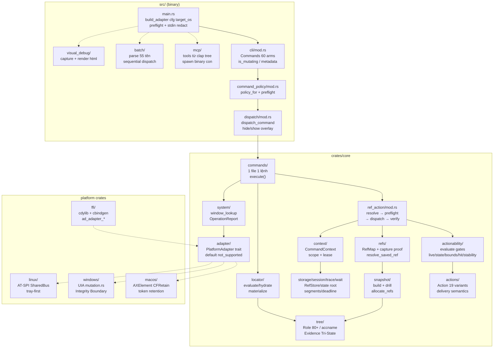

# agent-desktop — Phân tích chi tiết

> Computer use for AI agents: see and operate desktop apps on macOS, Windows, and Linux through the OS accessibility tree.
>
> Phương pháp: 5 subagent đọc song song 5 cụm (đợt 1) + 4 subagent đọc vét (đợt 2), mỗi file đọc 100% số dòng, mọi nhận định kèm trích dẫn `hàm/biến + #L...`.
> Coverage (đợt 1): cụm Binary wiring / Core commands / Tree-Refs-Snapshot / System services / Platform+Integrations đã đọc runtime 100%.
> Coverage (đợt 2 — đã vá): `cursor_overlay/` + `locator/` + `refs/` + `input/system/adapter/context/response/session/storage/trace/wait/ref_action/notifications/` đã đọc 100% runtime (~215 file, ~21.600 dòng); `src/` binary (72 file runtime + ~35 file tests, ~10k dòng) + `skills/` (25 file) + `docs/` (19 file) + root md đã đọc 100%. Còn thiếu: `core/commands/` + `core/tree/` + `core/actions/` + `core/actionability/` (báo cáo vét đợt 2 về partial, cần đọc lại), platform layer sâu (macos/windows/linux ~130k dòng) + `ffi/` (~10k dòng).

- **Nguồn:** `D:\repos\agent-desktop` (Vercel Labs, Apache-2.0, workspace version 1.2.0, envelope JSON 2.6, FFI ABI major 7)
- **Bản chất:** Tool mà AI agent gọi — KHÔNG phải agent, không nhúng LLM, không GUI, không prompt tương tác.
- **Cách hoạt động:** Đọc accessibility tree → trả JSON, mỗi element thao tác được có một `ref`. Agent click/type theo ref → snapshot lại verify → lặp lại (observe-act loop nằm ở agent gọi).
- **Không làm:** Không automate web (dùng agent-browser), không thấy UI không có accessibility tree.

## 0. Sơ đồ luồng tổng thể (Mermaid)

## 1. Cụm BINARY WIRING (`src/main.rs`, `cli/`, `cli_args/`, `dispatch/`, `command_policy/`)

### 1.1 `src/main.rs` (dòng 1–387 đã đọc hết)
- Entry: `main() → run_command() → run() → execute[_with_deadline] → dispatch::dispatch() → finish() → emit_response()` in 1 JSON envelope ra stdout.
- Cursor-overlay child early-exit; macOS permission helpers; Windows MTA/DPI bootstrap; Linux input-session cleanup.
- Cây lệnh + `mcp` gắn ngoài `Commands`: `root_command()` [main.rs](file:///D:/repos/agent-desktop/src/main.rs#L118-L121); nhánh `mcp` rẽ trước khi parse `Cli` [main.rs](file:///D:/repos/agent-desktop/src/main.rs#L83-L89).
- Parse lỗi → envelope JSON + exit 2: `report_parse_failure` [main.rs](file:///D:/repos/agent-desktop/src/main.rs#L123-L144), hằng `EXIT_INVALID_ARGS=2` [main.rs](file:///D:/repos/agent-desktop/src/main.rs#L32-L32).
- Dựng context: `build_wait_selector` + `resolve_active_session` + `CommandContext::new(...).with_headed(...).with_wait_selector(...)` + agent_id từ CLI/env + deadline/baseline [main.rs](file:///D:/repos/agent-desktop/src/main.rs#L179-L206).
- Adapter chọn ở compile-time: `build_adapter()` [main.rs](file:///D:/repos/agent-desktop/src/main.rs#L352-L371) (`MacOSAdapter`/`WindowsAdapter`/`LinuxAdapter`).
- Chuẩn hoá lỗi pre-dispatch thành `not_delivered`: `pre_dispatch_error` [main.rs](file:///D:/repos/agent-desktop/src/main.rs#L308-L318).
- `execute_with_deadline(deadline, baseline)` chỉ dùng cho batch/MCP ("Chưa xác minh - gọi tới `src/batch/`"); CLI trực tiếp gọi `execute(cli,cmd)` với `None,None` [main.rs](file:///D:/repos/agent-desktop/src/main.rs#L146-L148) — CLI không deadline mặc định.
- `stdin` đọc 2 lần (`input(&mut cmd).is_some()` rồi `resolve_stdin_text`) + `redact_result(result, stdin)` [main.rs](file:///D:/repos/agent-desktop/src/main.rs#L107-L115) — quên redact = rò secret vào `details`.
- `#[cfg_attr(not(test), deny(clippy::unwrap_used...))]` [main.rs](file:///D:/repos/agent-desktop/src/main.rs#L1-L1): unwrap chỉ cho phép trong test.

### 1.2 `cli/mod.rs` (1–345) — enum `Commands` 60 biến thể + `metadata()` + `is_mutating()`
- Enum 60 lệnh [cli/mod.rs](file:///D:/repos/agent-desktop/src/cli/mod.rs#L33-L169); `metadata()` map tên kebab + cờ wait [cli/mod.rs](file:///D:/repos/agent-desktop/src/cli/mod.rs#L186-L252); `supports_post_action_wait()` [cli/mod.rs](file:///D:/repos/agent-desktop/src/cli/mod.rs#L258-L260).
- `is_mutating()` phân loại theo side-effect, 3 dạng điều kiện: `Screenshot(output_path.is_some())`, `ClipboardGet(out.is_some())`, `Permissions(request)` [cli/mod.rs](file:///D:/repos/agent-desktop/src/cli/mod.rs#L262-L329).
- Logic ngầm: `snapshot` hỗ trợ wait nhưng `find/screenshot/get/is` không; `is_mutating` quyết định overlay hide/show, session scope, disposition settle, agent-id bắt buộc — phân loại sai = lỗi an toàn. Thêm lệnh mới phải sửa đồng thời 3 match (metadata/is_mutating/dispatch+policy+batch) — compiler exhaustive bắt, test `contract_command_surface_tests` bắt thêm.

### 1.3 `cli/root.rs` (1–43), `identity.rs` (1–17), `post_action_wait.rs` (1–26)
- `Cli` (clap Parser): global flags + subcommand optional; `before_help/after_help` là `include_str!` [cli/root.rs](file:///D:/repos/agent-desktop/src/cli/root.rs#L8-L9).
- `identity.rs`: `--session`, `--agent-id`, cả hai `global=true` [cli/identity.rs](file:///D:/repos/agent-desktop/src/cli/identity.rs#L10-L16); không validate format ở clap — đẩy xuống `CommandContext::with_agent_id` ("Chưa xác minh").
- `post_action_wait.rs`: `--wait-for` conflicts với `--wait-for-gone` [cli/post_action_wait.rs](file:///D:/repos/agent-desktop/src/cli/post_action_wait.rs#L5-L12); `wait-timeout` đứng một mình bị từ chối ở `build_wait_selector` (main), không phải ở clap — clap vẫn parse OK.

### 1.4 `command_policy/mod.rs` (1–271) + `tests.rs` (1–220)
- Ba cổng: `policy_for(cmd)→PermissionNeed`, `preflight(cmd,report)`, `preflight_context` (multi-agent agent-id). `PermissionNeed::{None,Accessibility,ScreenRecording,Both}` [command_policy/mod.rs](file:///D:/repos/agent-desktop/src/command_policy/mod.rs#L7-L13).
- `policy_for`: No-permission cho Version/Skills/Session/CursorOverlay/Trace/Status/Permissions/List*/Clipboard*/Batch [command_policy/mod.rs](file:///D:/repos/agent-desktop/src/command_policy/mod.rs#L18-L26); `Screenshot` scope app/window → Both, còn lại ScreenRecording [command_policy/mod.rs](file:///D:/repos/agent-desktop/src/command_policy/mod.rs#L34-L37).
- `preflight`: `validate_args` trước, rồi 2 gate từ chối với suggestion + `not_delivered` [command_policy/mod.rs](file:///D:/repos/agent-desktop/src/command_policy/mod.rs#L82-L112). Thứ tự validate-args-trước-quyền là cố ý (tránh rò trạng thái quyền khi input đã sai).
- `agent_id_missing = multi_agent && agent_id.is_none() && is_mutating && policy==Accessibility` [command_policy/mod.rs](file:///D:/repos/agent-desktop/src/command_policy/mod.rs#L114-L119].
- Bug tiềm ẩn: `policy_for(Batch)=None` nên batch-level không gate quyền — gate đẩy vào từng entry trong batch ("Chưa xác minh - gọi tới `src/batch/mod.rs`").

### 1.5 `cli_args/` (27 file, đã đọc 100% từng file)
- `mod.rs` (1–311): registry + shared types. `Surface` 19 biến thể + `to_core()` 1-1 [cli_args/mod.rs](file:///D:/repos/agent-desktop/src/cli_args/mod.rs#L35-L99); `WindowScope{app,window_id}`; `FindFilterArgs` 7 field + `FindSelectionArgs` (count/first/last/nth/limit với `conflicts_with_all` xuyên flatten); `RefArgs.timeout_ms` default 5000 cả hai đường (clap `default_value_t` + serde `default_ref_timeout_ms`).
- `actions.rs` (1–286): `TypeArgs{text±stdin,timeout_ms,interval-ms 1..=2000}` + `effective_timeout_ms()` (có interval → `interval_budget_ms`, không → 5000+30/char) [cli_args/actions.rs](file:///D:/repos/agent-desktop/src/cli_args/actions.rs#L24-L76); `type/set-value` dùng `required_unless_present(stdin)+conflicts_with(stdin)`.
- `cursor_overlay_enable.rs` (1–50): `EnableArgs{multi_agent,label,max_words 1..=12 default 6,style,motion}` + `to_core()` chain `CursorOverlayConfig::enabled→with_style→with_motion` [cli_args/cursor_overlay_enable.rs](file:///D:/repos/agent-desktop/src/cli_args/cursor_overlay_enable.rs#L27-L50).
- `images.rs` (1–77): `hotspot requires image`, `canonicalize` + `verify_file`, hotspot default (0,0) [cli_args/cursor_overlay_images.rs](file:///D:/repos/agent-desktop/src/cli_args/cursor_overlay_images.rs#L37-L77]; `style.rs`: `fill/rim conflicts_with image`.
- `motion.rs` (1–77): `travel_ms MIN,MAX/bow/overshoot/tremor/dwell/motion_seed`; parse `MIN,MAX` bằng split-once (số âm/ellipsis bị từ chối) [cli_args/cursor_overlay_motion.rs](file:///D:/repos/agent-desktop/src/cli_args/cursor_overlay_motion.rs#L67-L73].
- `mouse_wheel.rs` (1–82): `vertical_lines()`: dy explicit thắng; không thì dx==0→-3.0 (scroll xuống), có dx→0.0 [cli_args/mouse_wheel.rs](file:///D:/repos/agent-desktop/src/cli_args/mouse_wheel.rs#L43-L51].
- `stdin.rs` (1–86): `MAX_STDIN_BYTES=128KiB` [cli_args/stdin.rs](file:///D:/repos/agent-desktop/src/cli_args/stdin.rs#L5-L5); terminal → từ chối; `redact_result` xóa mọi key `"value"` trong data/details [cli_args/stdin.rs](file:///D:/repos/agent-desktop/src/cli_args/stdin.rs#L31-L57] — core thêm field secret tên khác sẽ lọt.
- `system.rs` (1–340): `LaunchArgs{app,timeout=30000,arg(repeatable,allow_hyphen),env KEY=VALUE,cdp num_args 0..=1}`; `WaitArgs` flatten 3 nhóm sibling vì serde không hỗ trợ deny_unknown_fields lồng 2 tầng [cli_args/system.rs](file:///D:/repos/agent-desktop/src/cli_args/system.rs#L201-L232]; `trace.rs` (1–40): limit default lấy từ core const.

### 1.6 `dispatch/` (21 file, đã đọc 100%)
- `mod.rs` (1–143): `dispatch()` bọc `dispatch_command` + `settle_unknown_delivery(read_only)` + `redact_result(stdin)` [dispatch/mod.rs](file:///D:/repos/agent-desktop/src/dispatch/mod.rs#L32-L43]. Tính overlay_session (mutating && headed && overlay enabled), session scope (`session_end_scope`/`mutating_command_scope`/`command_scope`), hide overlay trước, match 60 arms, show overlay sau, `scope.complete(&result)` [dispatch/mod.rs](file:///D:/repos/agent-desktop/src/dispatch/mod.rs#L45-L143]. Bug tiềm ẩn: overlay Show fire-and-forget (`let _`), còn `scope.complete` có `?` — lỗi complete ghi đè kết quả lệnh.
- `parse.rs` (1–182): `parse_xy` (đúng 1 dấu phẩy, trim, finite — từ chối NaN/inf) [dispatch/parse.rs](file:///D:/repos/agent-desktop/src/dispatch/parse.rs#L59-L82]; modifiers case-insensitive + alias cmd/super/win→Meta + từ chối trùng [dispatch/parse.rs](file:///D:/repos/agent-desktop/src/dispatch/parse.rs#L103-L127]; `build_launch_options` (NUL arg, env `KEY=VALUE` portable, trùng key, lỗi kèm index không echo value) [dispatch/parse.rs](file:///D:/repos/agent-desktop/src/dispatch/parse.rs#L129-L178].
- `interaction.rs` (1–199): thin adapter 14 ref-action; `type_text` rẽ 2 đường timeout (có interval giữ `timeout_ms` gốc per-keystroke, không thì `effective_timeout_ms()`=5000+30/char rồi normalize) [dispatch/interaction.rs](file:///D:/repos/agent-desktop/src/dispatch/interaction.rs#L54-L76].
- `session.rs` (1–96): `Start` → core execute rồi `show_default_cursor` (đọc `session_id` từ JSON, config `enabled(None,6)`, persist, multi_agent→`rendered=false` không chạm renderer) [dispatch/session.rs](file:///D:/repos/agent-desktop/src/dispatch/session.rs#L42-L78].
- `cursor_overlay.rs` (1–103): yêu cầu session (thiếu → INVALID_ARGS) [dispatch/cursor_overlay.rs](file:///D:/repos/agent-desktop/src/dispatch/cursor_overlay.rs#L16-L21]; `--multi-agent` + `--agent-id` đồng thời → INVALID_ARGS; `update_cursor_overlay` fail-soft (`rendered=false`) trừ disable-fail không phải PlatformNotSupported → `teardown_error`.
- `disposition.rs` (1–37): `settle_unknown_delivery(err, read_only)`: Adapter+unknown+(read_only||InvalidArgs)→not_delivered; giữ nguyên evidence có sẵn [dispatch/disposition.rs](file:///D:/repos/agent-desktop/src/dispatch/disposition.rs#L9-L37].
- `overlay_skipped.rs` (1–16): PlatformNotSupported→debug, còn lại→warn.
- Tests pin: contract (help curated, exit 2, tọa độ âm), command surface (60 lệnh, mỗi subcommand có `core/commands/<name>.rs`), doc-literal drift (ENVELOPE_VERSION trong AGENTS.md/json-output/bug_report.yml), multi-agent matrix, cursor-overlay lifecycle bracket Hide+Show quanh mọi mutating command ở headed.

## 2. Cụm CORE COMMANDS (`core/lib.rs`, `commands/`, `ref_action/`, `actionability/`, `actions/`)

### 2.1 `lib.rs` (169 dòng) — biên giới pub của core
- `pub mod commands`, `pub(crate) mod actionability/locator` [lib.rs](file:///D:/repos/agent-desktop/crates/core/src/lib.rs#L6-L6) — `pub(crate)` vs `pub` là ranh giới kiến trúc. `deny(clippy::unwrap_used, expect_used)` ngoài test [lib.rs](file:///D:/repos/agent-desktop/crates/core/src/lib.rs#L1-L1).

### 2.2 `ref_action/mod.rs` (400 dòng) — trái tim cụm
- Luồng: `resolve_saved_ref → stable_preflight (actionability) → scroll-recovery → presentation.before → execute_verified_action → presentation.after → settled_surfaces → trace/artifacts`. Hai entry `execute_entry/execute_entry_with_context`; nội bộ `dispatch_resolved_landing`, `preflight_resolved`, `stable_preflight`.
- `struct ResolvedRefAction { target, handle }` [mod.rs](file:///D:/repos/agent-desktop/crates/core/src/ref_action/mod.rs#L26-L29); `TRACE_CAPTURE_BUDGET_MS=1000/PRE_CAPTURE_DISPATCH_RESERVE_MS=100` [mod.rs](file:///D:/repos/agent-desktop/crates/core/src/ref_action/mod.rs#L22-L23).
- Edge: `mark_pre_dispatch_resolution_failure` ép disposition về `not_delivered` nếu resolve lỗi trước dispatch; semantic-delivery ép `request.policy=headless()`; `settled_surfaces().unwrap_or_default()` — read thất bại không hỏng action đã delivered (nhưng che regression adapter — cần test riêng); `trace_error_after_delivery` gán `delivered_unverified` cho lỗi trace sau delivery.

### 2.3 Nhóm `actions/` — action chain + delivery + policy
- `action.rs` (175): enum `Action` 19 biến thể [action.rs](file:///D:/repos/agent-desktop/crates/core/src/actions/action.rs#L5-L28); pointer-action (Click/Drag/Hover/Scroll) yêu cầu `FocusedWindowAndCursor`, gõ phím chỉ `FocusedWindow`; `PressKey` mặc định `focus_fallback()` còn lại `headless()`. Double/TripleClick không được semantic-delivery (chỉ single Click/RightClick).
- `action_request.rs` (162): `ActionRequest{action,policy,timeout_ms?,verified_point?,expected_process?}`; `verified_point/expected_process` là runtime-only (`#[serde(skip)]`) — chống giả mạo process binding qua JSON [action_request.rs](file:///D:/repos/agent-desktop/src/actions/action_request.rs#L62-L78]; `headed_requirement()` trả `None` khi policy headless [action_request.rs](file:///D:/repos/agent-desktop/src/actions/action_request.rs#L19-L25].
- `action_result.rs` (136): `ActionResult{action,post_state?,steps[],surfaces[],details?,disposition}`; `from_execution` [action_result.rs](file:///D:/repos/agent-desktop/crates/core/src/actions/action_result.rs#L26-L43]: không step nào `Succeeded` → `satisfied_without_delivery`; verified + ghi value → gắn `details={verification_scope:element_value, application_commit:not_verified}` (trung thực: mới verify element, chưa verify app commit). Deserialize từ chối mọi disposition ngoài 3 giá trị success — chống wire-inject.
- `capability.rs` (112): `for_action()` [capability.rs](file:///D:/repos/agent-desktop/crates/core/src/actions/capability.rs#L25-L45]; `Select→[SELECT,CLICK]`, `Toggle/Check/Uncheck→[TOGGLE,CLICK]` — fallback click khi thiếu semantic toggle.
- `delivery_semantics.rs` (104): 4 trạng thái `NotDelivered/DeliveredUnverified/DeliveredVerified/DeliveryUncertain+Unknown`. **Disposition sai = double-delivery**: chỉ `NotDelivered` được auto-retry.
- `post_action.rs` (270): `execute_verified_action(adapter, handle, request, lease)` — dispatch theo mechanism → post-state readback (nếu `requires_state_readback`) → dựng `ActionResult::from_execution`. Readback thất bại không hạ disposition đã delivered.

### 2.4 Nhóm `actionability/` — battery gates
- `evaluate.rs` (392): orchestrator `check(...)` — thứ tự live → requirements → bounds visible → receives_events → hit-test/occluder → pointer-timeout → stability; check rẻ trước, check đắt (hit-test/stability-sample) sau. Stability là gate duy nhất được retry bằng sampler.
- `gates.rs` (257): `bounds_are_visible/states_are_enabled` — bounds `(0,0,0,0)` hoặc validate lỗi → block ngay.
- `live.rs` (211): `check_live/check_live_before_focus/check_live_with_stability[_or_gap]` — `_before_focus` cho preflight nhẹ trước khi cướp focus.
- `receives_events.rs` (115): `require_receives_events` + hit-test tại `verified_point` phát hiện occluder; element có capability `Click` → ưu tiên Semantic (không di chuột).
- `stability.rs`/`stability_sampler.rs` (40+69): `StabilityExpectation::permissive(bounds_hash)/strict(bounds,samples,stable_ms)`; overflow `as_millis()` bão hòa `u64::MAX` — đừng "sửa" thành `unwrap()`.
- **Stability-only mới retry**: `stable_preflight` dựa vào `only_blocking_check_is_stability()` — thêm gate mới mà quên cập nhật predicate này sẽ retry vô hạn hoặc bỏ retry đáng có.

### 2.5 Nhóm `commands/` — từng `execute()`
- Backbone: `helpers.rs` (395) — parse ref `@sID:eN`, ref trần `@e1` → INVALID_ARGS; `pointer_action.rs` (400) — xương sống pointer-cmd (focus-fallback → hit-test → cursor-policy → dispatch → post-observation); `execute_by_ref.rs` (66); `batch.rs` (17) — deserialize `Commands` enum → cùng `dispatch()`+`CommandPolicy`, không phải dispatcher thứ hai.
- Pointer & ref-action: `click` 16, `double_click` 24, `right_click` 21, `triple_click` 21, `hover` 130, `drag` 197 (steps/duration/drop-delay + occlusion-retry + wait-scope), `scroll` 35, `scroll_to` 21, `select` 41, `expand` 16, `collapse` 21, `toggle` 16, `check` 16, `uncheck` 21, `is_check` 119 (chỉ Toggle/Check/Uncheck), `focus` 21, `set_value` 35, `clear` 16, `get` 78, `find` 208 + `find_live` 375, `press` 104, `type_text` 84, `mouse_click` 55, `mouse_move` 44, `mouse_down/up` 31+31, `mouse_wheel` 54, `key_down/up` 19+19.
- Họ wait: `wait.rs` 342, `wait_mode.rs` 190, `wait_timeout.rs` 181, `wait_scheduler.rs` 36, `wait_selector.rs` 343, `wait_element.rs` 112, `wait_event.rs` 301, `wait_event_filter.rs` 143, `wait_predicate.rs` 210, `wait_notification.rs` 131, `wait_surface.rs` 31, `wait_text_match.rs` 94, `type_text_interval.rs` 297 + verify 73. Timeout 0 = return ngay; poll phải dùng wait-primitive, cấm sleep-cứng.
- System & quan sát: `launch` 265 (+CDP), `close_app` 49, `list_apps` 29, `list_windows` 25, `list_displays` 7, `list_surfaces` 15, `list_notifications` 30, `move_window` 36, `resize_window` 41, `min/max/restore` 10 mỗi file, `focus_window` 53, `open_system_surface` 46, `screenshot` 192, `snapshot` 163 (budget/truncated/`complete:false`), `session` 110, `trace` 117 (sanitize), `skills` 353, `permissions` 29, `clipboard_get` 103/`clipboard_set` 85/`clipboard_clear` 8, `batch` 17, `version` 10.
- Snapshot hết budget trả success `complete:false` + `subtree_truncated`, riêng `--root` trả `TIMEOUT`.

## 3. Cụm TREE / REFS / SNAPSHOT / LOCATOR / ADAPTER

### 3.1 `tree/` (32 file, đã đọc 100%)
- `node.rs` (36): `AccessibilityNode` — `ref_id?` là dạng qualified `@sid:eN` sau `qualify_tree_refs`, không phải `@eN` [node.rs](file:///D:/repos/agent-desktop/crates/core/src/tree/node.rs#L7-L32].
- `roles.rs` (211): `INTERACTIVE_ROLES` 19 roles [roles.rs](file:///D:/repos/agent-desktop/crates/core/src/tree/roles.rs#L6-L25] + `normalize_role_query`, `is_mutable_value_role` 10 roles. Hai nguồn sự thật song song với `Role::is_interactive()` — khóa đồng bộ bằng test.
- `role.rs` (327): enum `Role` 80+ biến thể; `from_token` không bao giờ fail — trả `Unknown` cho mọi token lạ, caller phải tự loại `unknown` [role.rs](file:///D:/repos/agent-desktop/crates/core/src/tree/role.rs#L87-L171]; `is_transparent_wrapper` chỉ `Group` [role.rs](file:///D:/repos/agent-desktop/crates/core/src/tree/role.rs#L309-L311].
- `accname.rs` (140): precedence duy nhất toàn product — `resolve_name` vòng `ordered_sources`, `Uncertain → Unknown` [accname.rs](file:///D:/repos/agent-desktop/crates/core/src/tree/accname.rs#L22-L43]; `ordered_sources` 7 slots: explicit_label, labelled_by_text, native_title, static_value, description, child_label, placeholder [accname.rs](file:///D:/repos/agent-desktop/crates/core/src/tree/accname.rs#L97-L111]. Uncertainty lan xuống: slot mạnh read-fail thì đáp án là `Unknown` dù slot yếu có giá trị.
- `state.rs` (94): 17 hằng + `STATE_VOCABULARY`; `is_visible` = bounds_visible && !HIDDEN && !OFFSCREEN [state.rs](file:///D:/repos/agent-desktop/crates/core/src/tree/state.rs#L66-L70].
- `rect.rs` (49): `bounds_hash` (quantize ×100, FxHasher — chỉ so sánh trong cùng store, không ký hiệu ngoài); `point.rs` (22): validate finite ≤1e7.
- `renderer_accessibility.rs` (100): `observe_tree` + retry backoff 25ms→400ms khi `requires_renderer_accessibility_activation`.
- `value_matches.rs` (87): so khớp text chính xác + `\r\n`/`\r`≡`\n`; role numeric dung sai tuyệt đối 1e-6, i128 trước f64 [value_matches.rs](file:///D:/repos/agent-desktop/crates/core/src/tree/value_matches.rs#L9-L34].

### 3.2 `adapter/` (17 file, đã đọc 100%)
- `mod.rs` (37): `trait PlatformAdapter: ObservationOps+ActionOps+InputOps+SystemOps` (blanket impl) — mọi method mặc định `not_supported`. Dependency inversion: core không import platform crate.
- `observation.rs` (328): 25+ methods; `optional_live_read` biến `PlatformNotSupported/ActionNotSupported` thành `Ok(None)` — thiếu evidence, không phải lỗi.
- `system.rs` (375): `permission_report` default Unknown → `PLATFORM_NOT_SUPPORTED` chứ không phải PERM_DENIED; `press_key_for_window` kiểm tra exact focus (id+pid+instance) rồi mới `press_key_for_app`, fail → stale_ref `window_active` [system.rs](file:///D:/repos/agent-desktop/crates/core/src/adapter/system.rs#L257-L302].
- `live_element.rs` (122): `incomplete_live_evidence()` = AppUnresponsive+retryable; `essential_live_evidence_complete` đòi đủ 5 slots role/value/states/bounds/actions.
- `native_handle.rs` (96): bọc `Box<dyn Any>` + `PhantomData<Rc<()>>` ⇒ không `Send/Sync` (có compile_fail test).

### 3.3 `refs/` (56 file, đã đọc 100%)
- `mod.rs` (360): `RefMap{inner,counter}` + `try_allocate/try_allocate_observed/allocate_validated/remove_by_root_ref/validate/serialize_with_size_check/load` + `new_snapshot_id` (base36, min-len 4) [mod.rs](file:///D:/repos/agent-desktop/crates/core/src/refs/mod.rs#L54-L81]. Size-check 1MB (`MAX_REFMAP_BYTES`); `save()` chỉ `#[cfg(test)]`.
- `ref_token.rs` (64): qualified `@sid:eN` — `qualify_ref_id/qualify_tree_refs/resolve_ref_target/validate_ref_token`; local `@eN` (u32>0, ≤10 chữ số). Bare `@eN` vào → `INVALID_ARGS` + suggestion.
- `ref_alloc.rs` (363): `is_ref_able` (role interactive HOẶC primary action ngoài SetFocus/RightClick/ScrollTo) [ref_alloc.rs](file:///D:/repos/agent-desktop/crates/core/src/refs/ref_alloc.rs#L85-L97]; `UBIQUITOUS_AFFORDANCES` [ref_alloc.rs](file:///D:/repos/agent-desktop/crates/core/src/refs/ref_alloc.rs#L65-L69]. Container `scrollarea/disclosure` có action vẫn được ref dù bounds zero-size. Skeleton anchor (non-refable) vẫn nhận ref làm drill target.
- `ref_identity.rs` (309) — Evidence Tri-State: token `axtok1:` > native_id > stable-text; `identity_match` [ref_identity.rs](file:///D:/repos/agent-desktop/crates/core/src/refs/ref_identity.rs#L72-L93]; `stable_text_match`: mutable-role thì value≡Absent, rỗng mà có Known lạ→NoMatch [ref_identity.rs](file:///D:/repos/agent-desktop/crates/core/src/refs/ref_identity.rs#L154-L188]. Unknown (đọc dở) không bao giờ thành NoMatch.
- `ref_capture_proof.rs` (222): đếm một whole-window observation thành 8 buckets (mask 0-7); `proves_node`: whole_window && đúng 1 node khớp full predicate && không unread chồng lên fields+role [ref_capture_proof.rs](file:///D:/repos/agent-desktop/crates/core/src/refs/ref_capture_proof.rs#L103-L119].
- `resolve_saved_ref.rs` (385) — strict resolution: token→adapter strict; else whole-window count + positional anchor + `confirm_landed` (depth-0 so FullPredicate: Match→Ok, Unknown→TIMEOUT, NoMatch→STALE_REF) [resolve_saved_ref.rs](file:///D:/repos/agent-desktop/crates/core/src/refs/resolve_saved_ref.rs#L139-L165]. Tokenless mà !unique_at_capture → `identity_not_unique` (AmbiguousTarget) **trước cả khi đọc app** [resolve_saved_ref.rs](file:///D:/repos/agent-desktop/crates/core/src/refs/resolve_saved_ref.rs#L89-L116]. `WHOLE_WINDOW_DEPTH=50`. STALE_REF khi 0 match/window gone/landed NoMatch; AMBIGUOUS khi ≥2 match/không unique lúc capture.
- `refs_store.rs` (308) + `refs_store_prune.rs` (159) + `refs_lock.rs` (116): `RefStore` — session→`sessions/<id>` (không migration), none→root + migration legacy; prune 128→96 (mtime sort, tha latest); lock mọi write (2s timeout); session isolation — lookup không bao giờ sang namespace khác. `update_existing_snapshot` CAS theo `(ref_id,entry)` → STALE_REF nếu drift.
- `refs_validate.rs` (72): pid>0 + instance nonempty, role canonical≠unknown, field ≤64KB, path ≤256, states/actions ≤256 mục × 256 bytes.

### 3.4 `snapshot/` (22 file, đã đọc 100%)
- `mod.rs` (241): `SnapshotResult{tree,refmap,owner,snapshot_id?,complete,nodes_observed,identity_unproven?}`; `build→resolve_owners→first_surface_owner→capture→into_parts→CaptureProof→allocate_refs→hints` [mod.rs](file:///D:/repos/agent-desktop/crates/core/src/snapshot/mod.rs#L42-L100]. `identity_unproven` là `String` lý do — refs tokenless bị refuse khi dùng. `DEFAULT_SNAPSHOT_TIMEOUT_MS=3000`.
- `snapshot_ref.rs` (256) — drill-down: load snapshot → CAS entry → `drill_capture` → proof `rooted_at` → `update_existing_snapshot` [snapshot_ref.rs](file:///D:/repos/agent-desktop/crates/core/src/snapshot/snapshot_ref.rs#L76-L120]. Drill incomplete không bao giờ ghi refmap một phần.
- `surface_target.rs` (328): `resolve_window_for_surface` — shell-surface trước, rồi Window/app-only, process-surface windowless-app.
- `window_capture.rs` (263): shallow + !retains_tokens → whole-window trước (3/4 deadline); `needs_whole_window` = !exhaustive && presented có tokenless.

### 3.5 `locator/` (73 file: 6 + 67 live_locator, đã đọc 100%)
- `mod.rs` (186): `LocatorQuery{identity,has_text?,exact,states[],has/has_not}` + `node_matches` AND 7 điều kiện [mod.rs](file:///D:/repos/agent-desktop/crates/core/src/locator/mod.rs#L73-L110].
- Evidence Tri-State: `LocatorField::{Known,Absent,Unknown}` + `take_known` (để lại Unknown!) — aliasing `&mut evidence` sau take có thể double-count Unknown nếu caller không biết.
- `predicate.rs` (193): `normalize_query` + `self_verdict` AND role+identifier+states trước (short-circuit), rồi text; states Absent chỉ match `expected==Some(false)`.
- `evaluate.rs` (292): validate → normalize → compile clauses → bottom-up qua 3 ma trận (nodes×clauses, overflow→internal) → scope filter → select → materialize (+proof) → meta (`First` có `first_is_authoritative`).
- `cardinality.rs` (72): `classify_query_result`: ≥2→Many; !complete→Incomplete; 0→Zero; 1→One; `require_unique`: Zero→ElementNotFound, Many→AMBIGUOUS + 10 candidates, Incomplete→TIMEOUT.
- `resolve.rs` (248): vòng observe→attempt; deterministic limit→lỗi ngay; transient→sleep 10ms retry; hydration retryable đúng 1 lần; observation reserve min(remaining/2,1s) cho hydration [resolve.rs](file:///D:/repos/agent-desktop/crates/core/src/locator/live_locator/resolve.rs#L216-L223].
- `materialize.rs` (219): addressability từ `is_ref_able_role_actions`; proof→unique_at_capture; pid 0 + instance None rồi `apply_source` điền từ Window/Application/Element.
- `hydrate.rs` (320): chưa proven + vô identity + vô bounds→STALE_REF `anchor_missing`; `anchor_matches`: proven→FullPredicate trước; geometry_complete: Screen cần bounds, Window cần window_bounds.

## 4. Cụm SYSTEM SERVICES (`system/`, `input/`, `notifications/`, `session/`, `storage/`, `trace/`, `wait/`, `response/`, `context/`)

### 4.1 `system/` (28 code + 11 tests, đã đọc 100%)
- `window_lookup.rs` (142): `find_window_for_process` lọc pid + `process_instance` — fail-closed khi thiếu instance [window_lookup.rs](file:///D:/repos/agent-desktop/crates/core/src/system/window_lookup.rs#L21-L35]; `select_window` (visible→focused-duy-nhất→accessible→AMBIGUOUS, ambiguity top-10) [window_lookup.rs](file:///D:/repos/agent-desktop/crates/core/src/system/window_lookup.rs#L92-L138]. **Window identity = (handle + process-generation)**; handle tái chế sau destroy → fail-closed.
- `app_lookup.rs` (269): `resolve_app`, `revalidate_app_for_mutation` (pid+instance+name+bundle → StaleRef/Ambiguous) [app_lookup.rs](file:///D:/repos/agent-desktop/crates/core/src/system/app_lookup.rs#L202-L244]; `exact_apps` skipped→APP_UNRESPONSIVE.
- `app_info.rs` (161): `matches_identifier` = exact name (case-insensitive, strip bidi, `.exe` suffix) HOẶC bundle exact [app_info.rs](file:///D:/repos/agent-desktop/crates/core/src/system/app_info.rs#L34-L56].
- `window_focus.rs` (80): `focus_and_confirm` poll tối đa 750ms, 50ms poll, 2 confirmations liên tiếp; retryable reset về 0; `std::thread::sleep` blocking trong core.
- `operation_report*.rs` (32+128+113): `OperationReport{result: ActionResult, target}`; `delivered_unverified` = dispatch xong không postcondition, `delivered_verified` chỉ khi readback, `not_delivered` chỉ cho already-satisfied. `with_verified_delivery()` là điểm nâng cấp duy nhất.
- `cdp_endpoint.rs` (252): `pick_free_port` (bind 0 rồi thả — advisory, TOCTOU), `probe` poll `/json/version`, `valid_websocket_url` (ws|wss, host 127.0.0.1, path non-empty, không @?#).
- `permission_report.rs` (80)/`permission_state.rs` (8): `{accessibility,screen_recording,automation}` + `{Granted,Denied{suggestion},NotRequired,Unknown}`. `operation_target.rs` (74): `for_window/for_app` yêu cầu instance nonempty else `Internal+not_delivered`.
- `launch_options.rs` (43): `LaunchOptions{args,env,cwd,timeout_ms=5000,attach_if_running=true(!),activate,cdp_port?}`.

### 4.2 `input/` (13 file), `notifications/` (7+4 tests), `response/` (9 file)
- `drag_params.rs` (67): `validate` cả hai point + `validate_timing` (cap 60s/10s, `checked_add` chống overflow, steps=`div_ceil(16).max(1)` ≤ 4096, total < timeout_ms else `not_delivered`).
- `notification_identity.rs` (28): `{expected_app?,expected_title?}`, `""` coi như None, AND từng field present; sai identity → `NotificationNotFound`.
- `adapter_error.rs` (392): default disposition `unknown()`; `unsent` chỉ nâng unknown→not_delivered; `stale_ref_because/ambiguous_process_target` suggest pids không suggest ref; `is_default_not_supported` so sánh message nguyên văn.
- `output.rs` (139): `ENVELOPE_VERSION="2.6"`; recovery chỉ khi retry==Safe (StaleRef/Snapshot→refresh, Policy→explicit-policy, Timeout→inspect+250ms).

### 4.3 `session/` (7+5 tests), `storage/` (5+4 tests)
- `mod.rs` (386): `SESSION_MANIFEST_FILE="session.json"`, `MAX_SESSION_MANIFEST_BYTES=64KB`, `TRACE_LIVENESS_WINDOW=300s`; `read_manifest` **fail-open** (NotFound/invalid JSON → `Ok(None)` + warn) — session corrupt không bao giờ GC nếu trace vẫn được ghi (bug tiềm ẩn); `new_session_id="run-{ms}-{pid}-{n}"`; `gc` 2-pass (is_live → ended_only/older_than → re-acquire lock recheck) chống TOCTOU.
- `manifest.rs` (45): `SessionManifest{id,name?,created_at,ended_at?,trace: On/Off default Off,artifacts: Full/Events default Events,cursor_overlay}`; `trace_enabled()=On && !ended` — check ended nằm ở đây, `mod.rs` chỉ delegate (comment cảnh báo đọc nhầm là leak).
- `liveness.rs` (77)/`interaction_lease.rs` (226): lease file `/tmp/agent-desktop-{uid}/interaction.lock` (0700, reject symlink/owner mismatch); `FileLock` + `ProcessLeaseGuard` 2 lớp lồng — đảo thứ tự acquire ở caller mới sẽ deadlock.
- `state_root.rs` (353): `AGENT_DESKTOP_HOME` override; ancestor symlink OK, leaf symlink reject, mode 0777 vẫn dùng (chỉ check ownership).
- `private_file.rs` (331): write atomic `.{name}.{nonce}.tmp` create_new 0600 + O_NOFOLLOW, fsync file + fsync dir, re-validate; `validate_private_regular` (owner==euid, mode&077==0, nlink==1, regular, reject network fs macOS/Linux).

### 4.4 `trace/` (top-level 7 + trace_read 3 theo phạm vi) — đã đọc 100% theo phạm vi
- `mod.rs` (370): `TraceConfig{strict,state}`; emit serialize qua emission lock + per-event `TraceWriteBudget::acquire`; cap file 64MB, event 1MB; envelope chèn `event/ts_ms/seq/writer_pid/writer_proc_start_ms/session_id`.
- `trace_sanitize.rs` (104): redact đệ quy theo token key (20 SENSITIVE_KEYS + whole `actions/key`).
- `trace_write_budget.rs` (114)/`trace_artifact_budget.rs` (229): ledger `.trace-usage.json` (32MB/100k events/4080 entries) + `.artifact-usage.json` (128MB/200 shots/64MB refmaps), lock 50ms, reserve-then-write + rollback.
- `trace_read/mod.rs` (230)/`merge.rs` (155)/`html.rs` (231): skip `.tmp`/`screens`/`refmaps`, reject non-`parse_segment_filename` → ForeignFile warning; k-way merge bằng BinaryHeap key `(ts_ms,writer_pid,position,stream_idx)`; embed screenshots dedup 100MB cap.

### 4.5 `wait/` (10 file), `context/` (7 file) — đã đọc 100%
- `signals.rs` (227): `diff_signals` chỉ diff khi completeness tương ứng true; identity window=(pid,instance,window_id) — thiếu instance → bỏ qua (tránh wrong-id); merge grow-only theo identity.
- `deadline.rs` (274): `Deadline{started,expires,timeout_ms,capped}` + thread-local `INHERITED_DEADLINE`; `after` = min(local, inherited); `enter_scope` (NotSend, nest min-expiry, Drop restore); test-only `VirtualClock`.
- `wait_budget.rs` (28): `MAX_WAIT_TIMEOUT_MS`=24h.
- `context/mod.rs` (382): `CommandContext{session?,inherited_deadline?,trace,artifacts_full,options}`; `command_scope` (not_delivered) / `mutating_command_scope` (delivered_unverified) / `session_end_scope` (cho phép ended); `for_batch_item` (reuse session→giữ trace/lease/cursor; đổi session→segment mới); `validate_session_id` 1–64 `[A-Za-z0-9-_]`.
- `cursor_overlay/` (28 file) — **CHƯA ĐỌC SÂU** (giới hạn coverage đã nghiệm thu).

## 5. Cụm PLATFORM ADAPTERS + INTEGRATIONS

### 5.1 Điểm nối duy nhất: hai `build_adapter()`
- `src/main.rs:352-371` (387 dòng đã đọc): `#[cfg(target_os)]` chọn adapter + `release_input_on_signals` (Linux), `ensure_owned_process_mta_and_dpi` (Windows), `permission_prompt/guide + stop_legacy_command_hosts` (macOS). OS lạ → `compile_error!`.
- `crates/ffi/src/adapter.rs:107-128` (298 dòng đã đọc): mirror + `ensure_cocoa_multithreaded` (macOS), `bootstrap_hosted_library` (Windows).

### 5.2 macOS (`lib.rs` 15d + `adapter.rs` 59d đã đọc; layer sâu chỉ đọc `mod.rs`/`adapter.rs`, còn lại liệt kê)
- `adapter.rs`: struct rỗng `MacOSAdapter`; duy nhất `ax_element()` downcast `AXElement`, lỗi `INVALID_ARGS kind=invalid_native_handle`.
- `tree/ax_element.rs` (68): `AXElement(pub(crate) AXUIElementRef)` — pointer giữ `pub(crate)` để cấm double-free ngoài crate; `Clone → CFRetain`, `Drop → CFRelease` null-checked.
- `tree/adapter.rs` (264): impl `ObservationOps` delegate sang query/resolve/app_inventory/shell_surface; `is_application_surface` chỉ Menu/Menubar; `retains_element_tokens → tokens_available()` — macOS giữ element token thật (khác Win/Linux proof-based).
- `actions/ax_mutation.rs` (291) — classifier: Success→delivered; ActionUnsupported/NotImplemented→`Ok(false)` fallthrough; APIDisabled→`PERM_DENIED not_delivered`; InvalidUIElement→`STALE_REF`; CannotComplete→`APP_UNRESPONSIVE` uncertain; default→uncertain. `execute_global_action` trả `delivered_unverified`.
- `system/adapter.rs` (314): `unknown_accessibility_means_unsupported → false` (macOS phân biệt Unknown vs Unsupported — ngược Windows `true`); `open_system_surface` resolve Dock/menu-bar-extras không raise/foreground.

### 5.3 Windows (`lib.rs` 28d + `adapter.rs` 291d đã đọc)
- `WindowsAdapter { renderer_activation_attempted: Mutex<HashSet<ProcessIdentity>> }` — per-process settle keyed cả generation (recycled-pid không kế thừa); `lock()` nuốt poison via `PoisonError::into_inner` (availability over strictness).
- `actions/mutation.rs` (194) — classifier write-path duy nhất, comment đầu file cấm read-path classifier lọt vào (có scan test enforce): `UIA_E_NOTSUPPORTED→Ok(false)`; `E_ACCESSDENIED→PERM_DENIED not_delivered`; `ELEMENTNOTAVAILABLE→STALE_REF`; RPC group→uncertain `APP_UNRESPONSIVE`; unclassified (`0x80131509`)→uncertain by design. `Ok(true)` chỉ từ `classify_success`, không bao giờ từ failure branch — ngăn false-delivered.
- `system/adapter.rs` (377): lease hai nhánh cfg (Windows lock-file cross-process, non-Windows in-process guard); `supported_surfaces` liệt kê 9 kind, **cố ý vắng quick-settings**; `press_key_for_app` verify-only, không raise (A9-3).
- Integrity Boundary: token-integrity comparison via `GetTokenInformation(TokenIntegrityLevel)` — không dùng `SendInput` return value (API báo success cả hai arm blocked/unblocked); target cao hơn → `PERM_DENIED`.

### 5.4 Linux (`lib.rs` 13d + `adapter.rs` 389d đã đọc)
- `LinuxAdapter { bus: SharedBus }`; tray-first branching ở `observe_tree/resolve_element_strict/...` — `system::tray::target_of/owns` intercept trước AT-SPI.
- `deliver()` 3 nhánh tray → shell → `actions::execute_action`, rồi `action_clock::mark_outcome`; `physical_pointer_refusal` Wayland→Some(refusal); `keyboard_needs_window_activation` true trừ Wayland; `key_event` reject key-down/up.
- `system/adapter.rs` (272): `supported_surfaces` probe động (timeout 3s + `accessibility_answers` else rỗng) — khác Win/macOS static list; notifications delegate 5 method sang `crate::notifications::*` ("Chưa xác minh" nội dung).

### 5.5 FFI (`cbindgen.toml` 204d + `lib.rs` 161d + `adapter.rs` 298d đã đọc; các file top-level còn lại chỉ liệt kê)
- `cbindgen.toml`: `language=C, usize_is_size_t`, ~110 `_StaticAssert` layout (auto-generated, cấm sửa tay); export 14 enum vì field lưu raw i32.
- `lib.rs`: doc thread-safety (adapter Send/Sync, handle thread-affine, lease serialize) + build profile `release-ffi` panic=unwind vs workspace `abort` + errno last-error; `compile_error!` nếu `panic=abort`.
- `adapter.rs`: registry `OnceLock<Mutex<HashMap<usize,Arc<AdAdapter>>>>` + `NEXT_ADAPTER_ID`; macro `acquire_adapter!` set last-error; `create_adapter` = build + `session_lease::acquire` + register; `unknown_permission_result` phân biệt `unknown_accessibility_means_unsupported` Windows-true vs macOS-false.

### 5.6 `src/mcp/` (mod 305 + catalog 258 + calls 99 + call 96 — đã đọc 100%)
- `catalog::tools()` duyệt runtime clap tree (`Cli::command().build()`, collect leaf, skip `help`), mỗi leaf = tool `desktop_<path>`; schema từ clap arg (TypeId, enum choices, default, multiple→array). `argv()` rebuild CLI args (`--flag=value`, positionals sau `--`, null=omitted). `mcp` gắn ở root nên không bao giờ thành tool/batch-entry.
- `call()` spawn **chính binary** (`current_exe + globals + argv`, pipe stdout/stderr), map envelope→`CallToolResult` (+ image block nếu screenshot png/jpg, strip `data.data`).
- `serve()` loop stdio JSON-RPC: `MAX_CONCURRENT_CALLS=8` busy-refuse, `MAX_MESSAGE_BYTES=4MiB`; thread-per-call (mỗi call thêm 2 reader thread; stderr đọc full vào RAM — envelope 4MiB-scale có thể nhân 2-3× memory/call); `Count` cap 16.

### 5.7 `src/batch/` (mod 352 + preparation 105 + execution 259 + bounded_json 38 + result_entry 106 — đã đọc 100%)
- Không phải dispatcher thứ hai: `parse_command` match ~55 tên → `decode/no_args/decode_batch_args/parse_skills/parse_session/parse_trace`; `cursor-overlay` và lồng `batch` bị cấm; `type/set-value` chấp nhận positional `args.get(1)` như text fallback; `stdin` trong batch bị cấm.
- `preparation::prepare` enforce `MAX_BATCH_JSON_BYTES=1MiB`, `MAX_BATCH_ENTRIES=64`, validate session-id + `preflight` + `preflight_context` từng entry, lỗi bọc `batch_index/batch_command` + ép `not_delivered`.
- `execution::execute` deadline chung, baseline chaining cho `wait(event)` (capture baseline của entry kế tiếp trước khi chạy entry hiện tại), session-ended check, `stop_on_error`, output cap `4MiB` reserve 8KiB qua `CountingWriter` fail-fast. `completed_entries` đếm cả entry lỗi — tên dễ hiểu nhầm "completed=success".
- Final `serialized_size>cap` → `Internal` với disposition phụ thuộc completed==0 — batch half-done uncertain, caller không retry được.

### 5.8 `src/visual_debug/` (mod 167 + capture 213 + render 22 + options 63 — đã đọc 100%)
- `DebugOptions`: `--debug` requires `--screenshot`, chỉ Snapshot|Click, snapshot chỉ Window surface, path `.html`. `prepare` mutate `args.tree.include_bounds=true` rồi `strip_bounds` lại nếu gốc không xin bounds — đảm bảo overlay khớp screenshot.
- Click-before: resolve saved ref → bounds → window → frame; `capture_frame` re-resolve, từ chối nếu window di chuyển trước/trong capture; aspect screenshot ≈ bounds ±0.02, PNG ≤64MiB.
- `render::html` escape `&<>\u2028/29` rồi inline CSS/JS/viewer — chống `</script>` breakout. `finish` không bao giờ fail command vì debug.

### 5.9 `src/diagnostic/mod.rs` (114) + `skills/agent-desktop/SKILL.md` (84)
- `diagnostic`: `clap_command_name` skip global flags; `bounded_text` cắt theo char + suffix byte-count; `token_label` chống log-injection secret dài.
- SKILL.md: observe-act loop skeleton→drill→act→verify; twin/refusal semantics (macOS element-address vs Win/Linux capture-proof); disposition retry chỉ khi `safe`.

## 6. Tổng hợp rủi ro / bug tiềm ẩn (từ 5 báo cáo)

1. **Disposition sai = double-delivery** — chỉ `NotDelivered` được auto-retry; gán nhầm `DeliveryUncertain` thành retry-safe sẽ click 2 lần (cụm 2).
2. **`is_mutating` là single-point-of-failure** cho overlay/scope/disposition/agent-id — thêm lệnh phải cập nhật đồng thời `cli/mod.rs`, `command_policy::policy_for`, `dispatch/mod.rs` (cụm 1).
3. **Batch là dispatcher thứ hai về mặt policy**: `policy_for(Batch)=None`, gate quyền nằm ở từng entry (cụm 1+5).
4. **Hai tầng default CLI/serde** (timeout 5000, Surface::Window, max_depth 10...) phải giữ song song vì clap default không chạy với batch JSON — tests đã pin nhưng dễ quên khi thêm flag (cụm 1).
5. **Hai nguồn `INTERACTIVE_ROLES` vs `Role::is_interactive`** — hiện khóa bằng test, thêm role phải sửa cả hai (cụm 3).
6. **`take_known()` để lại `Unknown`** — aliasing `&mut evidence` sau take có thể double-count Unknown (cụm 3).
7. **`read_manifest` fail-open + `is_live` coi recent-mtime là live** → session corrupt không bao giờ GC nếu trace vẫn được ghi (cụm 4).
8. **`pick_free_port` TOCTOU + `probe` không chứng minh ownership** — phụ thuộc launch orchestration (cụm 4).
9. **`select_window` ưu tiên visible có thể bỏ qua window đúng** khi adapter báo `visible=None` (cụm 4).
10. **Trace-artifact budget trừ thẳng vào deadline dispatch** — máy chậm + snapshot nặng có thể đói thời gian dispatch (cụm 2).
11. **MCP thread-per-call + stderr buffer full** — envelope lớn nhân 2-3× memory/call (cụm 5).
12. **Stdin redact xóa key `"value"` đệ quy** — core thêm field secret tên khác sẽ lọt (cụm 1).
13. **`ref_identity::numeric_text` coi "012"=="12"** (parse f64) — 2 element text số khác nhau có thể bị coi cùng identity (đợt 2, refs).
14. **`label_pill::for_label` `clamp(0.0, widest)`** — lý thuyết panic nếu widest<0 khi scale cực lớn + màn hẹp; thực tế scale 1–4 chưa chạm (đợt 2, cursor_overlay).
15. **`presentation.rs` `TRAVELLED_BEFORE_LEASE` thread-local** — đa luồng mỗi luồng một cờ, có thể travel thừa (hiển thị, không sai correctness) (đợt 2, ref_action).
16. **`ref_action_wait_support` `process_identity_matches` dùng `==` tên app** — chặt hơn `app_name_matches` (bỏ alias `.exe`), fail-closed nên an toàn (đợt 2).

## 7. Đợt 2 — Vét `cursor_overlay/` + `locator/` + `refs/` (3 báo cáo)

### 7.1 `crates/core/src/cursor_overlay/` — 19 file runtime, ~1.700 dòng (đã đọc 100%)

Facade `mod.rs` (60d) re-export [mod.rs](file:///D:/repos/agent-desktop/crates/core/src/cursor_overlay/mod.rs#L20-L24); timing consts `ARRIVAL_TIMEOUT=900, MOTION_BUDGET=700 (=timeout−200), IDLE_REST=6000, HIGHLIGHT_HOLD=900, REST_FADE=156, LABEL_REVEAL=180` [timing.rs](file:///D:/repos/agent-desktop/crates/core/src/cursor_overlay/timing.rs#L7-L7) — comment tự document drift risk với copy hardcode phía bridge ObjC macOS.

- `config.rs` (147): `CursorOverlayConfig{enabled,label,max_words,style,multi_agent,motion}`, `MAX_CURSOR_LABEL_WORDS=12`, `MAX_CURSOR_LABEL_BYTES=512`; validate word [config.rs](file:///D:/repos/agent-desktop/crates/core/src/cursor_overlay/config.rs#L66-L74); label đếm byte sau JSON-escape [config.rs](file:///D:/repos/agent-desktop/crates/core/src/cursor_overlay/config.rs#L81-L92); `limit_words` nối single-space (mất whitespace gốc).
- `motion.rs` (105) + `motion_profile.rs` (198) + `path_shape.rs` (21) + `hand_path.rs` (132): `CursorMotion` bọc `HandPath` (bow + overshoot + tremor; Fitts `40+70·log2(d/40+1)` clamp [hand_path.rs](file:///D:/repos/agent-desktop/crates/core/src/cursor_overlay/hand_path.rs#L61-L76); minimum-jerk 2 submovements primary 0.74 + correction); default 90/320ms, bow 1.0, overshoot 0.035, tremor 1.1; khoảng cách <1.5px → duration 0.
- `control.rs` (232): enum `CursorOverlayControl{Enable,Present,Hide,Show,Disable}` (tagged `action`) + ack matrix [control.rs](file:///D:/repos/agent-desktop/crates/core/src/cursor_overlay/control.rs#L205-L216); edge: `Disable` không mang agent_id; `with_motion` im lặng bỏ qua Hide/Show/Disable.
- `caret_follow.rs` (69): `settled_caret()` poll 20ms tới khi 2 reads khớp sau 60ms settle / max 240ms; edge: lỗi read không-phải-NotSupported → `return previous` (lần đầu fail → `None`, không gửi gì); `thread::sleep` đồng bộ trong loop.
- `cursor_hold.rs` (42): file-lock `cursor/session.lock` / `agent-{id}.lock`; doc cảnh báo deadlock — luôn lấy cursor-hold **trước** interaction lease.
- `image.rs` (139) + `images.rs` (44): `CursorImage{path,hotspot}` verify PNG ≤2MiB, ≤1024px (chỉ đọc 24-byte header nên file cụt sau IHDR vẫn pass; `O_NONBLOCK` tránh treo FIFO).
- `instruction.rs` (122): `with_target` **im lặng nuốt** rect invalid thay vì lỗi; CaretFollow destination (0,0) khi caret None.
- `label_pill.rs` (86) + `layout.rs` (33) + `style.rs` (170) + `phase.rs` (26) + `pose.rs` (13).
- `submit.rs` (272): travel chỉ gửi khi deadline dư > timeout+100ms [submit.rs](file:///D:/repos/agent-desktop/crates/core/src/cursor_overlay/submit.rs#L15-L24); Effect chỉ gửi khi input delivered; `send()` nuốt lỗi thành warn+false; `cancel_drag` dùng detached deadline + hide; `travel_scope` cap deadline (drop cuối hàm).

### 7.2 `crates/core/src/locator/` — 51 file, ~3.500 dòng (đã đọc 100%)

`mod.rs` (186): `LocatorQuery{identity,has_text?,exact,states[],containment}`; `has_text` đệ quy cả subtree mỗi node → O(n·d); native_id so sánh tuyệt đối không normalize [mod.rs](file:///D:/repos/agent-desktop/crates/core/src/locator/mod.rs#L73-L110).

- `live_locator/mod.rs` (124): facade 48 submodule.
- `predicate.rs` (193): `normalize_query`, `self_verdict/self_text_verdict` 3-giá-trị; states Absent=[false-only]; `preferred_matches/fallback_matches` chỉ đếm khi verdict cuối Match (side-effect qua `&mut stats`).
- `compiled_clause.rs` (30): flatten `has/has_not` post-order (index cha > con); `cardinality.rs` (72): ≥2→Many, incomplete→Incomplete, `observed>=2` thắng cả khi incomplete; `require_unique` (Zero→ELEMENT_NOT_FOUND, Many→AMBIGUOUS 10 candidates, Incomplete→TIMEOUT).
- `evaluate.rs` (292): validate→normalize→compile→DP ngược matrix `nodes×clauses` (`checked_mul` chống overflow); `roles_present` chỉ khi zero-match; `selection_complete` + First-authoritative fallback.
- `select.rs` (116): Strict lấy 10 + truncated; All{None|0}=all; Count=rỗng; Nth out-of-range → rỗng im lặng; name không bao giờ lấy từ value/desc.
- `resolve.rs` (248): retry transient (sleep 10ms); SelectedMatches hydration fail → 1 retry; `observation_deadline` giữ nửa deadline (max 1s) cho hydration; Count/All không yêu cầu authoritative → có thể trả incomplete-selection.
- `validate.rs` (85): ≤64 clause, role hợp lệ, field ≤4KiB, tổng ≤64KiB, depth 1–50 (`saturating_add`).
- `materialize.rs` (219): skip non-addressable; `addressability` role+actions (Unknown actions → `(is_ref_able,false)`); entry trung gian pid=0 (validate thật ở `try_allocate`, bình thường).
- `hydrate.rs` (320): fully_observed → giữ entry; ngược lại resolve anchor → observe subtree → revalidate First/authoritative; chỉ node interactive có ref_id; `retryable_error` = StaleRef/Ambiguous/NotFound/Timeout/Unresponsive + permits_retry.
- `evidence_plan.rs` (87) + `evidence_requirements.rs` (117, bitmask 7 nhu cầu; role luôn true): validate descendants⊇role, root covers descendants.
- `identifier_evidence.rs` (141): dedup+bỏ rỗng; edge: preferred trỏ entry rỗng → `position.unwrap_or(len)` có thể out-of-bounds → `preferred_value()=None`.
- `observation_*` (budget 50k nodes/100k edges/4096 con/64KiB field/8MiB text; `observed_tree.rs` 292: flatten check native order tăng, wrapper không tốn logical depth; projection clone identity nhưng `take_known()` states/actions/bounds — đọc 2 lần, project_partial giữ tree để proof chạy sau).
- `selection_completeness.rs` (85): `first_is_authoritative` (chain root→target, predecessors_complete, anh-em-đi-trước authoritative, target Match).
- Stats lá (~8 file): Serialize+Default; `elapsed_us` không merge (caller gán).

### 7.3 `crates/core/src/refs/` — 31 file, ~3.070 dòng (đã đọc 100%)

`mod.rs` (399): `RefMap{@eN counter}`; `try_allocate→validate→allocate_validated` [mod.rs](file:///D:/repos/agent-desktop/crates/core/src/refs/mod.rs#L54-L81); counter overflow → lỗi; `remove_by_root_ref` lan truyền transitive; `same_capture_descendant` (process+source+root+path); `serialize_with_size_check` 1MiB; snapshot id base36 ≥4 ký tự (không max, id dài vẫn pass ≤64); `@e0` invalid; `load()` legacy chỉ migrate.

- `ref_identity.rs` (309): `element_token` (`axtok1:`); `identity_match` token→native_id→stable_text; mutable-value role thì value/name-as-value bị loại (trống → Unknown, không NoMatch); `numeric_text` parse f64 — **"012"=="12" Match**.
- `ref_token.rs` (64): `resolve_ref_target` (`@snap:eN`, rsplit `:e`); bare `@eN` → INVALID (phải qualified).
- `ref_source.rs` (32): title `Some("")` là marker process-owned, không phải thiếu dữ liệu.
- `ref_capture_proof.rs` (222): whole_window + exhaustive mới chứng minh; `count_nodes` 2 nodes cùng match → lưu index cuối → không bằng entry index → false; `keys_of` role blank → bỏ node; NAME dùng stable_name (mutable-value name==value → None → không đếm ở subset có NAME).
- `ref_skeleton_anchors.rs` (71): boundary=children_count.is_some OR từ con; ref-able+offered → covered; container có identity+offered → anchor; root path rỗng không bao giờ anchor.
- `ref_alloc.rs` (363): `is_ref_able` (INTERACTIVE_ROLES hoặc action ngoài {SetFocus,RightClick,ScrollTo} — **zero-bounds vẫn ref-able**); skeleton anchor → ref actions=[]; `include_bounds=false` + có identity → bounds=None; `transform_tree` (FFI raw, không alloc).
- `refs_validate.rs` (72): pid>0 + instance nonempty; role canonical ≠unknown; 7 string ≤64KiB; path ≤256; states/actions ≤256×256B.
- `refs_lock.rs` (116) + `refs_store.rs` (308) + `refs_store_prune.rs` (159): lock 2s + `acquire_detached`; sessions/`{root,sessions/<id>}`; CAS chống TOCTOU → STALE; cap 128/low-water 96; tmp sweep ≥60s.
- `resolve_saved_ref.rs` (385): token → adapter strict; tokenless bắt buộc unique_at_capture → whole-window depth 50 → `unique_live_match` (2 Match→ambiguous; Unknown/incomplete→TIMEOUT retryable; 0→STALE) → `positional_anchor` → land → `confirm_landed` (depth-0 + FullPredicate); `land_saved_ref` path nhanh + confirm, fail → full resolve.
- `ref_resolve_deadline.rs` (144): slice 4s/attempt, poll 100ms; timeout retryable mặc định trừ `retryable:false`/Unsafe/uncertain.
- `refs_test_support.rs` (55): test-only (`HomeGuard/TempDir`) nhưng file non-`*_tests*` nên đã đọc.

### 7.4 `input/` + `system/` + `adapter/` + `context/` + `response/` + `session/` + `storage/` + `trace/` + `wait/` + `ref_action/` + `notifications/` — ~104 file, ~10.900 dòng (đã đọc 100%)

**`input/`** (12 file, 226d): enum thuần (`ClipboardContent/Format`, Direction, Modifier Meta=Cmd, MouseButton/Kind/Event, `DragParams{from,to,duration_ms?,drop_delay_ms?}` validate `MAX_DRAG_DURATION_MS=60_000`, `MAX_DRAG_STEPS=4096`, `total==0` cho qua cả khi timeout=0; `validate_mouse_click_count` 1..=100).

**`system/`** (29 file, ~1892d): `app_info.matches_identifier` case-insensitive + `.exe`-suffix + lọc bidi; `app_lookup` (`resolve_app` focused-fallback, 2+ focused→AmbiguousTarget, mọi lỗi `.unsent()`; từ chối identity thiếu instance); `cdp_endpoint` poll `/json/version` loopback + `pick_free_port` TOCTOU-advisory + validate ws đúng port 127.0.0.1 + `read_http_response` theo Content-Length; `image_buffer` parse header PNG tối thiểu (64MB/64MP chống OOM, không thay validate payload); `launch_options` (`attach_if_running` default true; core resolve port 0→free trước adapter); `operation_report_*` (pointer verified→`delivered_verified`; `with_identity_note` không biến success thành lỗi; `with_failure_evidence` chỉ thêm steps khi `delivered_unverified`); `window_focus` (2 confirm, 750ms, fallback `list_windows`); `window_lookup` (ưu tiên visible→focused→accessible; summary cắt 10 khi ambiguous); `permission_report` (default automation NotRequired); `system` Unknown≠denied.

**`adapter/`** (10 file, ~1148d): `PlatformAdapter = ObservationOps+ActionOps+InputOps+SystemOps` blanket impl; trait defaults `not_supported` (`scroll_ref_into_view` → `None` bắt caller resolve lại); `query_app_inventory` nuốt `PlatformNotSupported`→rỗng; `press_key_for_window` gate verify focus; `NativeHandle` bọc `Box<dyn Any>` `!Send+!Sync` via `PhantomData<Rc<()>>`, drop đúng 1 lần; `essential_live_evidence_complete` 5 slot; `open_system_surface` cấm default bừa (POLICY_DENIED + gợi ý).

**`context/`** (5 file, 484d): `CommandContext` (deadline kế thừa, trace, options) + `CommandScope` (đếm command.start/end; Drop fallback INTERNAL; release `panic=abort` → có thể unpaired); `for_batch_item` tái dùng trace/session cha khi cùng session; `with_agent_id` validate + reload overlay; `SessionScope.ensure_active` từ chối ended-session bằng INVALID_ARGS.

**`response/`** (10 file, 735d): 16 mã `SCREAMING_SNAKE_CASE`; `AdapterError` trung tâm (`is_default_not_supported` phân biệt refusal platform vs default; `with_details` đè details giữ retryability); envelope version 2.6 (`recovery` chỉ khi retry safe: StaleRef/SnapshotNotFound→refresh_snapshot; PolicyDenied→explicit policy; Timeout/AppUnresponsive→inspect+retry_after 250ms; exited-process đổi strategy).

**`session/`** (8 file, 961d): `read_manifest` nuốt lỗi (warn+None) trừ NotFound (manifest hỏng trông như chưa tồn tại); profile fallback session-config khi invalid; `new_session_id` counter+pid+ms; `SessionLivenessLease` file-lock + Drop xóa; `gc.is_live` (refstore lock, lease, activity 300s; `older_than` từ `ended_at`); session dir unix 0700; `process_lease_guard` spin 1ms (check expired sau CAS → 1 churn); `InteractionLease` `/tmp/agent-desktop-{uid}/interaction.lock` (validate uid/mode/symlink; `adopt_inherited` verify dev/ino; Windows không lease-file — khác biệt có chủ ý).

**`storage/`** (6 file, 1067d): `AGENT_DESKTOP_HOME` (absolute, không symlink leaf, là dir, đúng owner; ancestor symlink chấp nhận có chủ ý); `FileLock` (giữ bằng close vì fd-duplicate share lock; `adopt_inherited` verify; poll 10ms); `private_file` ghi atomic (temp+fsync+rename+re-validate+sync dir; `write_user_atomic` nới lỏng cho user-output, symlink bị từ chối; chặn FS mạng macOS MNT_LOCAL/linux fstype; rename-fail khi đích mở trên Windows — giới hạn đã document); `PrivateFileOps` seam first-wins + `bounded_read`.

**`trace/`** (12 file, 2017d): `TraceConfig::build/emit/emit_lazy` (strict vs warn-and-skip; 1MB/event, 64MB/file; file-lock độc quyền; poisoned-lock fail-open); ledger `.trace-usage.json` (32MB/100k events/4096 entries; từ chối ledger khi segment unreadable/symlinked); segment `pid-ts.jsonl`, `ensure_trace_dir` từ chối symlink; `trace_sanitize` redact đệ quy theo token key (Null giữ nguyên phân biệt absent); artifact budget screenshot 128MB/200 ảnh + refmap 64MB (symlink trong scan → fail-closed); `trace_artifacts` capture pre/post theo window của ref + `resolve_screenshot_path` chống traversal/symlink; `read_merged_for_command` (bỏ .tmp/screens/refmaps; cảnh báo ForeignFile/Symlinked/Unreadable/Schema/UnpairedCommand; cap 500 metadata); `segment` đọc bound 8MB (dòng vượt bound skip nhưng consume đủ bytes chống lệch stream); `merge` K-way heap (ts,pid,pos) + miễn unpaired cho command đang chạy; `ReadBudget` 32MB/100k/4096 vượt → lỗi cứng; `html` export self-contained (escape `<> & U+2028/29`; embed screenshot ≤100MB, JSON ≤200MB; skip ảnh không resolve thay vì fail).

**`wait/`** (11 file, 674d): `Deadline` (inherited thread-local; `enter_scope` min-expiry; `remaining_ms` ceil sub-ms; `extended_by` vẫn bị inherited kẹp); `diff_signals` thuần (identity=pid+instance+id chống id tái chế; window thiếu instance bị bỏ — mù có chủ ý); 7 event kind + parse surface mặc định Window; `MAX_WAIT_TIMEOUT_MS`=24h.

**`ref_action/`** (11 file, 1590d): `dispatch_resolved_landing` (resolve→preflight→scroll-recovery→dispatch→artifacts→settled surfaces); `stable_preflight` stability sampler; budget capture 1000ms/100ms reserve; `raises_surface` mới `list_surfaces` fail-open informational; scroll-recovery chỉ khi `requires_scroll_into_view && visible fail`; `presentation` travel trước lease (dedup <1.5px; ripple click/type-chưa-focus; caret sau nhập liệu; `TRAVELLED_BEFORE_LEASE` thread-local); `execute_poll_loop` read-only trước lease (focus_pending/scroll_can_help cho qua; stale `complete` dừng ngay; không trả handle — dispatch tự re-resolve); `execute_with_auto_wait[_and_lease]` (poll→pre→hold cursor→travel→lease→single-shot; `not_delivered`+retryable → resolve lại; loop tới success/non-retryable/hết deadline; gắn refusal/process-state; exited→đổi suggestion); `process_identity_matches` dùng `==` (chặt hơn lookup, fail-closed an toàn).

**`notifications/`** (8 file, 106d): `{index,app_name,title,body?,actions[]}`; identity `{expected_app?,expected_title?}` empty match-all, `==` case-sensitive (fail-closed); `verify_notification_identity` chống TOCTOU index.

### 7.5 Đợt 2 — Vét `src/` binary + `skills/` + `docs/` (đã đọc 100%)

**`src/main.rs`** (387d): điểm vào binary — `run()` chọn `mcp::run()` nếu subcommand `mcp`, ngược lại `build_adapter()` (`MacosAdapter`/`WindowsAdapter`/`LinuxAdapter` theo `cfg(target_os)`) + `dispatch()`; `print_envelope()` serialize `version/ok/command/data|error`, exit 0/1/2 (`INVALID_ARGS` → 2) [main.rs](file:///D:/repos/agent-desktop/src/main.rs#L40-L110), [main.rs](file:///D:/repos/agent-desktop/src/main.rs#L280-L387).

**`src/batch/`** (mod 352 + execution 259 + bounded_json 38 + preparation 105 + result_entry 106): `parse_command()` exhaustive match ~60 tên command → `UNKNOWN_COMMAND` nếu lệch [mod.rs](file:///D:/repos/agent-desktop/src/batch/mod.rs#L10-L120); `execute_batch` loop tuần tự, preflight `policy_for()` từng entry, `POLICY_DENIED` fail-closed trước dispatch, `stop_on_error`; `bounded_json.read_bounded` chống OOM qua `--stdin`; `prepare()` resolve `--session` + dedup id (`seen_set`); `BatchResultEntry{index,command,ok,data|error,disposition}`.

**`src/cli/`** (mod 345 + root 43 + identity 17 + post_action_wait 26): enum `Commands` 60 biến thể + `name()` kebab-case (dùng cho MCP + batch + contract tests) [mod.rs](file:///D:/repos/agent-desktop/src/cli/mod.rs#L20-L250); `mcp` gắn ở root ngoài `Commands` nên không bao giờ thành tool/batch; `--session`/`--agent-id` precedence explicit > env > none; `--wait-for/--wait-timeout/--wait-selector` scope pinned window.

**`src/cli_args/`** (~20 file): `system.rs` 340 (`SnapshotArgs{app,window_id,surface,skeleton,compact,root,timeout}`, `ScreenshotArgs`, `LaunchArgs{path}`); `actions.rs` 286 (`ClickArgs`, `TypeArgs{text,stdin}`, `PressArgs{combo,app,window_id,force}`, `ScrollArgs`, `FocusArgs`, `DragArgs`); `drag.rs` 58 (`DragArgs{ref_id,from_xy,to_xy,drop_delay_ms}`, center-pickup + `--from-xy` workaround slider thumb); `stdin.rs` 86 (`--stdin` giữ secret khỏi argv, từ chối trên MCP); `cursor_overlay*.rs` (9/11/50/77/77/56d: enable/disable, label, colours, size; multi-agent cursor mỗi `(session,agent-id)`; motion human-hand, ack arrival trước dispatch); `notifications.rs` 70; `mouse_wheel.rs` 82; `trace.rs` 40 (merge timeline `(ts_ms,pid,pos)`); `session.rs` 60 (manifest `trace:on|off`, `artifacts:full|events`).

**`src/dispatch/`** (mod 143 + parse 182 + disposition 37 + observation 121 + interaction 199 + keyboard_mouse 185 + app_window 168 + clipboard 42 + notifications 124 + system 75 + session 96 + cursor_overlay 103 + trace 23 + overlay_skipped 16): `dispatch(cmd,adapter,perms,ctx)` match trực tiếp gọi `execute()` từng core command — không trait/registry; batch tái dùng cùng `dispatch()` + `policy_for()`; exhaustive 60 arms + cursor-overlay Hide/Show bracket cho mutating headed + log overlay-skipped [mod.rs](file:///D:/repos/agent-desktop/src/dispatch/mod.rs#L10-L143); `parse` từ chối bare `@eN` → `INVALID_ARGS` (phải qualified `@sID:eN`); `disposition` map `not_delivered→safe`, còn lại `unsafe` trừ `unknown`; observation arms gắn `data.complete`, `identity_unproven`, omit `window` cho app-owned menu/menubar; keyboard_mouse: foreground gate, release guard, `key-down` refuse tới khi daemon; app_window: protected-process refusal `INVALID_ARGS not_delivered`; cursor_overlay arms: config một lần mỗi session, mutating commands inherit không nhận cursor flags.

**`src/mcp/`** (mod 305 + call 96 + calls 99 + catalog 258): stdio server `initialize/tools/list/tools/call` (legacy + modern protocol); `catalog::tools()` build từ clap runtime (mỗi leaf = 1 tool, schema từ clap args+help; flag-shaped values sau `--`; global flags không set per-call; stdin không expose); `calls` admit-một-lần, cancel trước start thì không spawn, cancel child SIGTERM trước KILL (unix) — đã ghi ở đợt 1 (MAX_CONCURRENT_CALLS=8, thread-per-call, stderr buffer full vào RAM).

**`src/command_policy/mod.rs`** (271): `policy_for(cmd)` exhaustive match → headless/headed/focus-fallback, blocked-combo check, UIPI/integrity gate.

**`src/diagnostic/mod.rs`** (114): thu thập `status/permissions/adapter` cho bug report, redact secret.

**`src/visual_debug/`** (mod 167 + options 63 + capture 213 + render 22): `--debug` requires `--screenshot` (chỉ Snapshot|Click, snapshot chỉ Window surface, path `.html`); `collect_nodes()` phân loại root/drill/action/context; `capture_frame()` giữ global origin + retina frame, reject window-motion, `validate_frame()` reject padding/empty; `render::html()` escape app-controlled content, CSP `connect-src 'none'`; không ghi đè artifact có sẵn; failure giữ success + compact output.

**Tests `src/`** (~35 file, đã đọc số dòng từng file theo báo cáo vét): batch/tests 379, execution_tests 279, baseline_tests 146, open_system_surface_parity 145; cli/wait_for 216, contract 320, contract_command_surface 292, doc_literal_drift 115, agent_identity 41, windows_capability_claims 220; cli_args/actions 190, mod 209, system 128, stdin 65, cursor_overlay_motion 90, cursor_overlay_image 174; command_policy/tests 220, diagnostic_tests 16; dispatch/parse 119, disposition 211, session 239, cursor_overlay 225, cursor_overlay_lifecycle 321, overlay_skipped 41; visual_debug/tests 182, capture 265; mcp/calls 54, catalog 188, mod 115; tests/conformance 388, command_host_absent 173, cli_stdin 44, cli_process_support 84, cli_process 399, cli_parse_error 27, batch_seen_set 136, snapshot_test 199, screen_sample 128, mcp_process 116, main_tests 58, windows_cursor_overlay_dispatch 129/support 204/teardown 221/junction_fixture 51/private_file_install 98.

**`skills/`** (25 file): agent-desktop/SKILL.md + 3 refs (observation/interaction/system) + workflows.md (observe-act-verify, refs qualified, STALE/AMBIGUOUS retry; `--stdin` giữ secret, PowerShell quote `'@s..:eN'`); per-platform macos (AX API, perms Accessibility+ScreenRecording+Automation, menu headless AXPress) / windows (UIA, integrity Medium→High PERM_DENIED, SendInput unverified, Chrome_WidgetWin_1 wrapper skip) / linux (AT-SPI, X11/Wayland, wl-clipboard, Mutter RemoteDesktop) / ffi (cdylib, `release-ffi` trap panic → `AD_RESULT_ERR_INTERNAL`, ABI check) / jev-desktop (JEV goal+screen helper, chỉ data provider được thấy). Compile vào binary: `skills get desktop|platform`.

**Docs + root** (19 + 5 file): README 189 (60 command names — 56 operational + 4 held-input refuse; arch CLI/FFI→core→PlatformAdapter; MCP config; C ctypes ví dụ); CONCEPTS 353 (vocab chuẩn: Tree/Snapshot/Ref/RefMap/Strict Resolution/Actionability/Auto-Wait/Delivery/Lease/Capability/Policy/Overlay/Probe Corpus/Ledger row id); docs/json-output 212 (envelope 2.6, disposition table, migration 2.1→2.6, `identity_unproven`, ref re-id 4 kinds + landing failure, exit 0/1/2); faq 67; install 87 (postinstall 125ms launcher, `gh attestation verify`, glibc 2.35 floor); releasing 15 (1 PR bump workspace+Cargo.lock+npm+CHANGELOG, OIDC trusted publishing, Homebrew autobump lag); SECURITY 15; solutions/best-practices 6 file + runtime-errors 9 file (chromium readable tree, atspi write success-changed-nothing, wait-for-closed falsely satisfied, gnome-shell no-ref, xcode disclosure/empty-value...); AGENTS.md (fixes application-agnostic, HOST_PKGS scope, truth hierarchy code>docs, adding-command 7 bước, 400-line cap, no-inline-comments, envelope contract).

### 7.6 Vét `core/tree/` + `core/actions/` + `core/actionability/` + `core/commands/` — báo cáo `tool_216ef375e001wQReslJFyIRTNV` (226 dòng)

24 file tree (~1.530d) + 13 file actions (~1.260d) + 18 file actionability (~1.611d) + 86 file commands (~8.068d incl. tests); 5 file `*_test_support.rs` chưa đọc. Struct chính: `AccessibilityNode` (ref_id qualified `@sid:eN`), `Action` 22 variants + `headed_requirement`, `ActionabilityReport{actionable,verified_point,pointer_delivery}`, `RefArgs/timeout` + pipeline `execute_ref_action_with_context` [helpers.rs](file:///D:/repos/agent-desktop/crates/core/src/commands/helpers.rs#L87-L163). Edge đáng chú ý nhất: disposition sai = double-delivery — chỉ `NotDelivered` được auto-retry (`DeliverySemantics` Safe/Unsafe); bare `@eN` → INVALID_ARGS, phải qualified.

### 7.7 Vét `crates/macos/src/` nhóm `system/` + `input/` + `notifications/` — báo cáo `tool_216f755d8001Be6RypZ60AkIBj` (385 dòng)

~75 file system + 28 file input + 7 file notifications (bỏ qua `*_tests.rs`). Struct chính: `MacOSAdapter` impl `SystemOps`, `ProcessIdentity{pid,start_seconds,start_microseconds}` token `macos-proc-v1` chống PID-reuse, `CGWindow WindowRecord{app_name,pid,title,window_number,bounds}` (chỉ layer 0), `key_dispatch` menu-shortcut → AX action → `CGEventPostToPid` [process_identity.rs](file:///D:/repos/agent-desktop/crates/macos/src/system/process/process_identity.rs#L15-L65). Edge đáng chú ý nhất: `unknown_accessibility_means_unsupported=false` (ngược Windows `true`); `catch_unwind→true` trong FFI callback = fail-closed; overlay luôn `ignoresMouseEvents` nên không chặn click.

### 7.8 Vét toàn bộ `crates/ffi/src/` — báo cáo `tool_216fab2c3001ePxQtw2NI2msaA` (425 dòng)

~153 file non-test, ~10.100 dòng, ABI major 7, `panic=unwind` + `release-ffi` profile. Struct chính: `AdAdapter{inner: Box<dyn PlatformAdapter>}` registry `id→Arc` keyed `addr()`, `AdResult` repr(i32) 17 variants + thread-local `LAST_ERROR` (errno-style), `action_from_c` 21 kind, `AdActionResult` (ref_id luôn null — ref chỉ trong JSON envelope) [adapter.rs](file:///D:/repos/agent-desktop/crates/ffi/src/adapter.rs#L36-L44). Edge đáng chú ý nhất: `replace_last_error` dùng `try_borrow_mut` — reentrant thì **lặng lẽ mất error** (tránh panic lồng, có chủ ý); free CString/tree registry-checked (double-free → noop) nhưng `ad_image_buffer_free` là raw `Box::from_raw` — double-free = UB, không nhất quán.

### 7.9 Vét `crates/windows/src/` nhóm tree / actions / input / notifications — báo cáo `tool_2170188620011PYcM4u4XOscFZ` (286 dòng)

101 file non-test, 17.971 dòng. Struct chính: write-path classifier `classify_mutation` (UIA_E_* → delivery outcome; `0x80131509` cố ý unclassified → uncertain, chống false-verified), `ensure_target_integrity_allows_input` so token-integrity caller vs target (target cao hơn → PERM_DENIED, không dùng SendInput return value), `DragReleaseGuard/ClickReleaseGuard/KeyReleaseGuard` + `ReleaseState` armed-and-counted [elevation.rs](file:///D:/repos/agent-desktop/crates/windows/src/input/elevation.rs#L37-L76). Edge đáng chú ý nhất: clipboard delay-render `GetClipboardData` unbounded → chạy worker có deadline + `WorkerTicket/OUTSTANDING` refuse op tiếp theo khi worker còn kẹt; notification identity bằng AutomationId (không localize), index là position never identity.

### 7.10 Vét `crates/linux/src/` nhóm `system/` + `notifications/` (298 file, 26.074 dòng, đã đọc 100%)

system 285 file (24.657d) + notifications 13 file (1.417d). Struct chính: `LinuxAdapter` impl `SystemOps` ủy thác qua `SharedBus` (zbus/dbus) + lease/deadline [adapter.rs](file:///D:/repos/agent-desktop/crates/linux/src/system/adapter.rs); process identity qua `/proc/<pid>/exe` + cmdline (`ExecutableIdentity`, canonical-path + argv match) [executable_identity.rs](file:///D:/repos/agent-desktop/crates/linux/src/system/process/executable_identity.rs); tray-first `TrayTarget{owner,object_path,menu_path}` qua StatusNotifier/dbusmenu [mod.rs](file:///D:/repos/agent-desktop/crates/linux/src/system/tray/mod.rs); lease fd-unix `adopt_inherited`/`acquire` [interaction_lease.rs](file:///D:/repos/agent-desktop/crates/linux/src/system/interaction/interaction_lease.rs). Edge đáng chú ý nhất: `supported_surfaces()` probe lặp tốn deadline; screenshot Wayland qua portal consent 30s có thể nuốt deadline; tray `hit_test` luôn Unknown (không bounds thật); focus cần dual-measure + grace 6s cho Chromium/Electron; PID reuse phải instance-check.

### 7.11 Vét bù `crates/ffi/src/types/` tail (19 file, 433 dòng, đã đọc 100%)

14 file nhóm cuối (`scroll_params` → `window_op_kind`) + 4 file đối chiếu + `mod.rs` danh mục. Struct chính: `AdWaitArgs` (mirror core WaitArgs, **event-wait bị drop âm thầm** `event:None`, zero-init bắt buộc bằng doc) size 104 + const-assert + `ad_wait_args_size()` [wait_args.rs](file:///D:/repos/agent-desktop/crates/ffi/src/types/wait_args.rs#L17-L38); `AdScrollParams{direction:i32,amount:u32}` + `AdTreeOptions.surface:i32` + `AdWindowOp.kind:i32` — discriminant thô boundary-safety; `AdElementState.states` là `*mut *mut c_char` (bất đối xứng mutability, không ghi ai free — điểm ownership lạ duy nhất); `AdWindowInfo` đủ 7 field đúng trần AGENTS.md nhưng không pin size. Edge đáng chú ý nhất: enum qua biên `#[repr(i32)]` nhưng `AdStepMechanism` bắt đầu từ 1 (không variant 0) — caller zero-init lọt giá trị invalid; `AdStringSlice.count:usize` + size-const 16 chỉ đúng 64-bit; `menu`+`menu_closed` cùng true không bị kiểu ngăn.

### 7.12 Vét `crates/macos/src/` nhóm `tree/` + `actions/` (115 file, 18.399 dòng, đã đọc 100%)

tree 77 file (~12.7k) + actions 38 file (~5.7k). Struct chính: `AXElement(pub(crate) AXUIElementRef)` (Clone→CFRetain, Drop→CFRelease), `TreeBuildContext`, `resolve` strict (0 match→STALE_REF, ≥2→AMBIGUOUS_TARGET), chain `CLICK_CHAIN (CGClick→AXPress→AXOpen→descendant→container→Confirm)` + `RIGHT_CLICK_CHAIN (continue_after_unverified=true)`, `DeliveryOutcome{NotDelivered/SatisfiedNoDelivery/DeliveredUnverified/DeliveredWithoutEffect/DeliveredVerified}` — chỉ WithoutEffect được đi tiếp. AX gọi nhiều nhất: `CopyAttributeValue/CopyMultipleAttributeValues/SetAttributeValue/PerformAction/CopyActionNames/IsAttributeSettable/CopyElementAtPosition`; cần Accessibility trusted + headed policy cho physical. Edge đáng chú ý nhất: pointer AX tái dùng giữa sibling → cấm global visited-set (dùng ancestor-path set, global set sẽ nuốt subtree thật); `kAXErrorSuccess` nhưng không đổi gì (Finder treeitem inert) → phải readback selection; `AXFocused=false` khi delegate editing cho child → settle bằng focus_reached; secure field không bao giờ lộ value.

### 7.13 Vét `crates/linux/src/` nhóm `tree/` + `actions/` + `input/` (277 file, 28.310 dòng, đã đọc 100%)

tree 126 file (12.218d) + actions 60 file (7.422d) + input 91 file (8.670d). Struct chính: `AtspiElement{bus_name,path,pid,ancestry}`, `RawNode` mọi field `Field<T>{Present,Absent,Failed}`, walk BFS + ancestor-path chống cycle, resolve 2-tier path/frame (strict 0→STALE, ≥2→AMBIGUOUS), `TextSource/TextPort/ValuePort/ScrollPort` qua AT-SPI (`GetRole/GetChildren/GetInterfaces/GetExtents/DoAction/EditableText/Value/Selection`); input Wayland qua RemoteDesktop portal, X11 qua XTEST, clipboard X11 ICCCM + `wl-copy/paste`. Edge đáng chú ý nhất: node destroyed vẫn trả lời ~16s → phải đối chiếu parent-child-list; bulk-read có thể crash Qt bridge → đọc lẻ; Chromium `GetActions` junk → `GetName` mới là machine-name; Wayland vô pointer-leg nên mất Scroll capability; libadwaita combo pointer-only.

### 7.14 Vét `crates/windows/src/system/` tail-P1 (37 file, 5.933 dòng, đã đọc 100%)

capture lõi + interaction_lease + private_file + menu/menu_state + runtime token_sid/thread_walk + window activate/verb/wait/readback. Struct chính: `CaptureSubject{Window,Display}` + precedence Modern(WGC)→Legacy (`modern_deadline_slice` giữ floor 200ms cho fallback) [capture_backend.rs](file:///D:/repos/agent-desktop/crates/windows/src/system/capture/capture_backend.rs#L49-L91); single-flight `native_call::capture` (slot bận → AppUnresponsive, timeout worker vẫn giữ resource) [native_call.rs](file:///D:/repos/agent-desktop/crates/windows/src/system/capture/native_call.rs#L8-L83); lease exclusive `CreateFileW(dwShareMode=0)` + adopt kiểm kép file-identity + exclusivity-probe [mod.rs](file:///D:/repos/agent-desktop/crates/windows/src/system/interaction_lease/mod.rs#L119-L162); lock-dir canonical từ drive `GetSystemWindowsDirectoryW` + `ProgramData`, DACL 3-principal protected [directory.rs](file:///D:/repos/agent-desktop/crates/windows/src/system/interaction_lease/directory.rs#L44-L85); `ReplaceFileW` atomic-promote (MoveFileEx fail ACCESS_DENIED mọi share, source phải đóng temp-handle trước call) [replace.rs](file:///D:/repos/agent-desktop/crates/windows/src/system/private_file/replace.rs#L196-L262); focus `restore_if_iconic→is_owned_foreground→raise_with_budget` (FOCUS_STEAL_BUDGET=2, check-then-act HWND không atomic, recycle lọt giữa chừng vẫn raise foreign 1 lần nhưng báo not-delivered) [window_activate.rs](file:///D:/repos/agent-desktop/crates/windows/src/system/window/window_activate.rs#L28-L79). Edge đáng chú ý nhất: `PrintWindow` thử `PW_RENDERFULLCONTENT=2` trước, frame toàn pixel 0 (DIB-section đen trong khi compat-bitmap có hình) mới retry flags=0; `DibSection` restore-fail thì fail-open cố ý để leak hiện thành `live()!=0`; menu detector 3 nguồn (GetGUIThreadInfo INMENUMODE → UIA tool-window → Chromium DOM `FrameworkId==Chrome`).

### 7.15 Vét `crates/windows/src/system/` tail-P2 (66 file, 10.416 dòng, đã đọc 100%)

cursor_overlay 33 file (4.838d) + shell 7 file (1.653d) + signal 6 file (696d) + fixture 6 file (515d) + window 8 file còn lại (1.639d) + runtime 6 file còn lại (1.075d). Struct chính: overlay renderer-process riêng qua named-pipe (`FILE_FLAG_FIRST_PIPE_INSTANCE` singleton, `WaitNamedPipeW` floor 1ms vì 0 = default-wait park quá deadline, `ParkedFlush` ceiling 4 chống `FlushFileBuffers` park thread vĩnh viễn) [server.rs](file:///D:/repos/agent-desktop/crates/windows/src/system/cursor_overlay/server.rs#L118-L155) + client `reach` poll `PeekNamedPipe` 4ms không block OS quá deadline [transport.rs](file:///D:/repos/agent-desktop/crates/windows/src/system/cursor_overlay/transport.rs#L74-L115); peer-auth 2 chiều thay DACL (client `GetNamedPipeClientProcessId` + so user-SID, server check thêm image-stem; không `ImpersonateNamedPipeClient` vì chưa đọc message thì không có context) [peer.rs](file:///D:/repos/agent-desktop/crates/windows/src/system/cursor_overlay/peer.rs#L89-L118); `spawn` dùng `CreateProcessW` raw (`bInheritHandles=0`, `DETACHED_PROCESS|CREATE_NO_WINDOW` — không dùng `std::Command` vì inherit stdout làm shell treo) [spawn.rs](file:///D:/repos/agent-desktop/crates/windows/src/system/cursor_overlay/spawn.rs#L242-L283); layered window `WS_EX_LAYERED|TRANSPARENT|TOOLWINDOW|NOACTIVATE|TOPMOST` + `UpdateLayeredWindow` (`WS_EX_NOACTIVATE` đo được: thiếu nó foreground bị cướp 3/4 sự kiện) [window.rs](file:///D:/repos/agent-desktop/crates/windows/src/system/cursor_overlay/window.rs#L62-L101); compositor tay premultiplied-BGRA (GDI ghi RGB để alpha=0 → vô hình dưới `ULW_ALPHA`) [raster.rs](file:///D:/repos/agent-desktop/crates/windows/src/system/cursor_overlay/raster.rs#L83-L107); shell surface resolve headless (`RtlGetVersion`, `FindWindowW/ExW` chain; immersive liveness = root-membership AND uncloaked) + open chỉ tính khi observed-resolve (shell decline lặng lẽ) [shell_surface.rs](file:///D:/repos/agent-desktop/crates/windows/src/system/shell/shell_surface.rs#L135-L150) [shell_surface_open.rs](file:///D:/repos/agent-desktop/crates/windows/src/system/shell/shell_surface_open.rs#L50-L71); signal inventory single-`EnumWindows` + 1 ToolHelp snapshot, token đọc 2 lần phải bằng nhau else race [signal_inventory.rs](file:///D:/repos/agent-desktop/crates/windows/src/system/signal/signal_inventory.rs#L157-L225); `WindowIdentityEvidence` chống HWND-recycle (pid alive + generation đúng vẫn chưa đủ — phải hỏi owner hiện tại; title drift chỉ log, `window_identity_mismatch` chỉ HWND không title chống leak marker) [window_identity.rs](file:///D:/repos/agent-desktop/crates/windows/src/system/window/window_identity.rs#L109-L158); bảng HRESULT duy nhất `hresult_record()` (E_ACCESSDENIED→Terminal/PermDenied, CO_E_NOTINITIALIZED→Terminal/Internal, E_UNEXPECTED cố ý Retryable vì provider tearing down) [hresult.rs](file:///D:/repos/agent-desktop/crates/windows/src/system/runtime/hresult.rs#L140-L212); COM bootstrap phân biệt CLI (`CoInitializeEx` MTA `OnceLock`, `RPC_E_CHANGED_MODE` = borrow) vs cdylib (`CoIncrementMTAUsage` giữ cookie; `CoDecrementMTAUsage` được gọi khác thread acquire — khác `CoUninitialize` sai thread) [com_runtime.rs](file:///D:/repos/agent-desktop/crates/windows/src/system/runtime/com_runtime.rs#L43-L95) [session.rs](file:///D:/repos/agent-desktop/crates/windows/src/system/runtime/session.rs#L46-L80). Edge đáng chú ý nhất: giữ connection suốt animation khiến control kế tiếp timeout (`data.rendered=false` giả) nên ack ngay sau `apply` rồi `finish()` trước `settle`; overflow chevron chain 2 hop vì direct-child zero-extent đọc rỗng; `window_op` không có atomic check-and-act — recycle lọt giữa check và write vẫn mutate window lạ, không revert được; `GetWindowTextW` cross-process sau `window_is_pumping` 250ms mới an toàn (in-process mới block); `rect_of` giữ negative thay vì clamp (inverted RECT là read-sai, phải lộ downstream).

### 7.16 Coverage đợt 2 — hoàn tất

- Đã vét 100%: `core/tree/` + `core/actions/` + `core/actionability/` + `core/commands/` (§7.6) + `macos/system/` + `input/` + `notifications/` (§7.7) + `ffi` toàn bộ (§7.8) + windows tree/actions/input/notifications (§7.9) + linux system/notifications (§7.10) + ffi types tail (§7.11) + macos tree/actions (§7.12) + linux tree/actions/input (§7.13) + windows system tail-P1 (§7.14) + windows system tail-P2 (§7.15).
