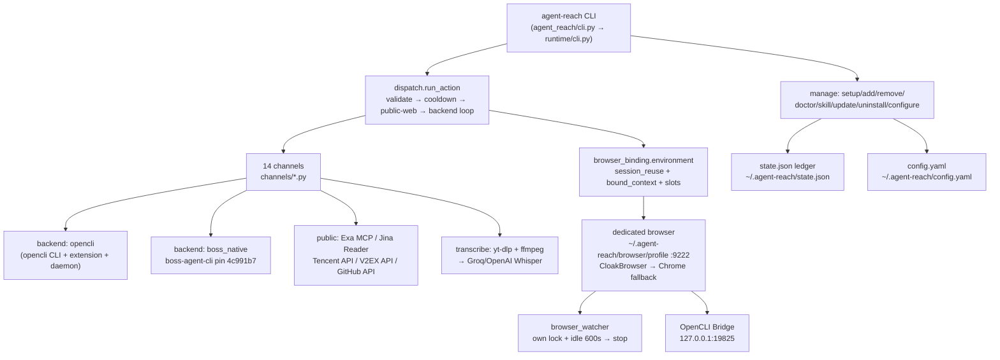

# agent-reach

> 让 AI Agent 够得着它自己上不去的互联网 — 登录墙后的平台、视频里的内容、中文平台、干净的结构化数据，一条命令拿到.

- **Nguồn:** `D:\repos\agent-reach` (bản đọc), tương ứng `research/repos/agent-reach`
- **Bản chất:** CLI + Skill cho AI agent lấy dữ liệu internet khó: sau login-wall, trong video, nền tảng TQ, output JSON cấu trúc sạch.
- **Stack:** Python 3.10+, entry `agent_reach.cli:main`
- **Version:** `1.6.0` (`agent_reach/__init__.py#L4-L6`), license MIT, `pyproject.toml` (hatchling, entry `agent-reach = agent_reach.cli:main`)
- **Docs:** README chính tiếng Trung, `docs/README_en.md`, `agent_reach/skill/SKILL.md` + `SKILL_en.md`, `llms.txt`
- **Tài trợ:** Bright Data, RapidProxy, BrowserAct, Tencent Cloud; trending GitHub, Discord.

## Kiến trúc tổng thể

Luồng lệnh: console script → `cli.main()` (ép UTF-8 Windows, strip `-v/--verbose`, tắt loguru) → `runtime/cli.main()` (extend PATH, apply proxy, route head) → `dispatch.run_action` → envelope JSON duy nhất ra stdout (logs → stderr), exit 0 = ok / 1 = lỗi.

Hai envelope khác nhau: agent command `{schema_version, ok, channel, action, backend, items, meta, error}` (`runtime/result.py`); management `{schema_version, ok, action, result, error}` (`runtime/cli.py#L78-L86`).

## Entry + Runtime core

- `agent_reach/__init__.py` (6 dòng): chỉ `__version__ = "1.6.0"`, không logic. Rủi ro: hard-code, lệch tag GitHub thì `update_notice` so sánh sai.
- `agent_reach/cli.py` (47 dòng): shim mỏng — `_ensure_utf8_console()` chỉ Win32, bỏ qua khi `PYTEST_CURRENT_TEST`; `_configure_logging(False)` gọi `logger.remove()` im lặng hoàn toàn. Bug nhỏ: strip `-v/--verbose` mọi vị trí nên param channel tên `verbose` bị nuốt.
- `agent_reach/config.py` (194 dòng): `~/.agent-reach/config.yaml`, read không bao giờ tạo file/dir; atomic write (`mkstemp` + `os.replace`, `fchmod 0600`, fsync file+dir), symlink guard 2 lần chống TOCTOU, `chmod 0600` bỏ qua trên Windows (điểm yếu có chủ ý). `get`: file trước, env `key.upper()` sau — key rỗng `""` trong file chặn env override. `set/delete` rollback bằng sentinel.
- `agent_reach/transcribe.py` (501 dòng): pipeline Whisper — download (`yt-dlp`) → compress (ffmpeg mono/16kHz/32k) → chunk 600s → POST Groq/OpenAI. Budget: `SIZE_LIMIT 24MiB`, `MAX_SOURCE 512MiB`, `MAX_CHUNKS 24`, `MAX_TOTAL 96MiB`. Privacy: auto mode chỉ gửi provider đầu tiên configured, fallback phải `allow_provider_fallback=True`. SSRF guard chỉ check literal IP (không DNS-resolve — giới hạn thiết kế, docstring ghi rõ). `_probe_audio_duration` parse `ffmpeg -i` stderr, fail-closed.
- `runtime/cli.py` (562 dòng): unified router. `_Parser.error` raise `_ArgError` → JSON `BAD_INPUT` thay vì `SystemExit(2)`. `--backend public-web` chỉ khi `action.public_web` non-empty. `_cmd_read` chọn channel qua `can_handle(url)` ưu tiên non-web; reddit + backend jina/exa ép về web. `login`: 3 đường (`--import-existing` + login_url → `session_reuse.prepare`; có login_url không `--sync` → `browser.start(login_url)` + `source=manual`; còn lại `sync_login()` hoặc subprocess `login_argv` với `{session}` templating, output → stderr). `logout`: clear session + `browser.clear_site` + xóa legacy `-cloak` + `forget()` đánh `blocked` + xóa `logout_keys`. `configure --stdin` đọc stdin, tty + key `-key` dùng `getpass`.
- `runtime/dispatch.py` (299 dòng): lõi fallback. `validate_action` → `cooldown()` (3600s, quét `cooldowns` + `setup_failures`) → `public_web.attempt` → `query_slot` (nếu backend opencli/boss-agent-cli) → vòng lặp backend: `backend_pause` skip (fingerprint đổi thì tha), `_pace_browser` (search/jobs spacing 10s), `_call_with_deadline` (thread daemon + `bind(clock)`, HTTP lì rò rỉ thread, subprocess tự kill). `FINAL_CODES = {NOT_FOUND, BAD_INPUT, PLATFORM_BLOCKED, RATE_LIMITED, NEED_LOGIN, BUSY}` dừng fallback. `only_backend` bypass pause (explicit override có chủ ý). Rate-limit → cooldown channel-wide.
- `runtime/run.py` (133 dòng): `run_cmd` (resolve binary, cwd mặc định `~`, kill group: Win `taskkill /T /F`, POSIX `killpg`, non-zero lấy dòng stderr cuối `_clean` 500 chars) + `http_request` (cap 8MiB, check Content-Length vs short read).
- `runtime/result.py` (142 dòng): mã lỗi NEED_SETUP/NEED_LOGIN/UPSTREAM_BROKEN/TIMEOUT/RATE_LIMITED/PLATFORM_BLOCKED/NOT_FOUND/BAD_INPUT + `BUSY` (literal string, không hằng — code smell nhưng so sánh đúng). `classify`: HTTP 404→NOT_FOUND, 429→RATE_LIMITED, timeout→TIMEOUT, FileNotFound→NEED_SETUP. `_clean` scrub credential + cắt 500 chars.
- `runtime/bridge.py` (91 dòng): OpenCLI Bridge `127.0.0.1:19825`, supervised chỉ khi dedicated browser mở. `require_compatible`: daemon khác version → NEED_SETUP, không restart. Race port: hai starter cùng thắng → `wait(5)` không claim.
- `runtime/manage.py` (966 dòng, lớn nhất core): `is_added` (default auto-added trừ `removed_defaults`); `add` (cài tools + browser setup + `on_add`, xóa reuse cũ); `remove` (clear cookies/site, `on_remove`, xóa legacy, xóa keys, `forget` + block reuse, prune tools); `setup` (migrate 1.5→1.6, cài defaults còn added, skill, receipt markdown); `sync`/`update` (check GitHub, uv reinstall hoặc sync tại chỗ, `_move_to_uv` parse dòng stdout cuối — giòn nếu bản mới in warning); `uninstall` (chỉ xóa owned_paths + private tools, giữ file lạ); `configure` (map groq-key/openai-key/proxy/github-token). `fingerprint` (version + code hash + browser profile + proxy + session revision + tool versions); evidence hợp lệ <24h (RATE_LIMITED <1h). `run_checks`: mặc định chỉ added, `PLATFORM_BLOCKED/RATE_LIMITED/NEED_LOGIN` break backend loop.
- `runtime/onboarding.py` (239 dòng): receipt + capability summary (tiếng Trung hard-code), `validate_cdp` chặn non-loopback chống SSRF. `installation_report` khi `installs` rỗng → `all([])=True` báo hoàn thành (edge hiếm). `require_boss_cdp` có side-effect dù docstring "read-only".
- `runtime/legacy.py` (124 dòng): tìm/xóa bản 1.5 (pipx venv hoặc `~/.agent-reach-venv`), loại trừ bản đang chạy, chỉ unlink shim trỏ vào venv cũ, giữ tool user.
- `runtime/state.py` (123 dòng): ledger `state.json`, `load` tolerant (hỏng → rỗng, mất history im lặng), `mutate` retry 100× qua file lock liên process (quá hạn → BUSY), `age_seconds` parse lỗi → `inf` (fail-closed), symlink-escape chặn 2 lớp.
- `runtime/update_notice.py` (69 dòng): notice chỉ từ `update --check` explicit, gắn `meta.update` vào mọi JSON trừ lệnh `update`. `version_tuple("1.6") < (1,6,0)` → True (edge nhỏ). Cache không TTL trong file này.

## Browser + Sessions (cơ chế login reuse)

- `runtime/browser.py` (915 dòng): owner dedicated browser, profile duy nhất `~/.agent-reach/browser/profile`. CloakBrowser ưu tiên, fallback Chrome hệ thống + ghi `backend/fallback_reason`. Watcher sở hữu, load OpenCLI, đóng sau 600s idle. `touch()` dùng `O_NOFOLLOW 0o600` + utime (comment race Windows rename). `observe_activity()` inject JS chỉ `event.isTrusted` (chống site giả input). Port 9222 cố định; Windows không phân biệt unmanaged browser (chỉ `watcher_running` quyết định). `ensure_chrome` offline-first (có executable+backend thì return). `restore_session` whitelist fields, lọc expires. `_clear_running_site`: đóng tab site, expire cookie, `clearDataForOrigin` mọi origin, verify lại. `setup()` không close login window đang mở (đúng). `_launch` env `PYTHONPATH` trỏ source tree — có thể version skew nếu cài package khác repo.
- `runtime/browser_binding.py` (154 dòng): `profile_for` luôn `"dedicated"`. `environment()` = `session_reuse.prepare` → `bound_context` → `bridge.require_compatible` → env `OPENCLI_PROFILE/WINDOW`, `CDP_ENDPOINT/TARGET=""` (OpenCLI tự resolve). Slots: 2/site + 4 global, `QUEUE_WAIT 120s`, `clock.pause()` khi xếp hàng. `exclusive_browser()` chiếm cả 4 slots cho login/restart/clear.
- `runtime/browser_watcher.py` (194 dòng): 3 mode (cloak persistent / pipe POSIX / watch Windows). `restore_session()` sau launch, `goto(launch)`. Idle loop `used=max(began,last_used)`, hết → `start_lock(5s)` + recheck + `stop()`. Locale hard-code `zh-CN` (fingerprint cố định). Pipe launch `about:blank` rồi `open_url` 2-step (race nhỏ, caller đã `wait_for`).
- `runtime/cdp.py` (222 dòng): CDP tối giản cho `127.0.0.1`, transports HTTP+WS debug port và pipe. `call` fixed id=1, đọc tối đa 32 frames (browser spam events có thể miss → caller retry). `extension_value` đọc `chrome.storage.local` qua service_worker.
- `runtime/sessions.py` (65 dòng): HOME riêng `~/.agent-reach/sessions/<tool>/` cho native CLI (độc lập cookie browser). `session_env` → `{HOME, USERPROFILE}`. `has_login_state` = rglob có file. `import_legacy_state` copytree (`symlinks=False` nên symlink nested thành copy nội dung — có thể copy file ngoài ý muốn, hẹp).
- `runtime/session_reuse.py` (126 dòng, trọng tâm auth): site-scoped, **không copy Chrome user thô/keychain** — nguồn duy nhất là OpenCLI `export_site_cookies` (browser local connected) hoặc snapshot Reach cũ. Account trùng (>1 context) → NEED_SETUP bắt chọn, không copy. Snapshot-not-overlay: expire stale + `setCookies` atomic một call, rollback khi fail. `verified:false` luôn — caller verify. `cookie_snapshot==1` version pin.
- `runtime/clock.py` (61 dòng): budget pauseable, thread-local, `off_the_clock` no-op khi không có clock. `remaining()` khi paused trả frozen (đúng).
- `runtime/public_web.py` (89 dòng): reuse `WebChannel`, không chạm browser. `_readable` conservative (title wall fullmatch có thể loại nhầm `"Login - Review"` — chấp nhận). `search` join `site:` có thể sai syntax nếu scope là path prefix (hẹp).
- `runtime/tools.py` (636 dòng): upstream tools private `~/.agent-reach/tools/`, kinds pip/npm/singleton-npm/prereqs. Pin: `cloakbrowser pip 0.6.3`, `opencli npm singleton floor 1.8.7 exclude 1.8.8 tested 1.8.7`. `resolve`: non-singleton ưu tiên private, singleton ưu tiên PATH. `ensure`: chrome → `browser.ensure_chrome()`; singleton out-of-limits không flag → hỏi user; `boss-agent-cli` pin `direct_url.json commit_id`. `extend_path` append sau PATH (ngược `resolve` — cố ý: con thừa hưởng nhưng không override user). `prune` O(n²) load nhưng n nhỏ.

## Channels (14 kênh, pattern ordered fallback)

`base.py` (111 dòng): `Param` → `Action(backends: Tuple[Tuple[str,str]], live_test, timeout, public_web)` + comment "dispatcher tries them in order" → `Channel` ABC (`level` default/optional/experimental, `session`, `login_argv`, `legacy_state`, `login_url`, `domains`, `tools`, `prereqs`, `logout_keys`, `needs_key`, `session_home`). `public_web` chỉ khai báo, implement ở dispatch.

`__init__.py` (60 dòng): import + instantiate sẵn 14 channel, `get_channel` lookup tuyến tính, `get_all_channels` trả list gốc (caller mutate được — bug nhỏ), không check trùng tên.

| Kênh | Level | Actions | Backend / upstream |
|---|---|---|---|
| bilibili | default | search, read, hot, subtitle | `bili-cli` + public `api.bilibili.com`; **đã loại yt-dlp** vì 412 risk-control; cần `SESSDATA` cho subtitle |
| v2ex | default | hot, node, read, user | public API thuần, urllib + curl fallback (TLS EOF), `_API_BASE`, validate chỉ `https://(www.)v2ex.com/api/` |
| github | default | search, read | `gh` primary + REST public fallback; token `GH_TOKEN/GITHUB_TOKEN` hoặc config; README cắt 50k chars, comments 50/page không paginate |
| youtube | default | read, search, subtitle, transcribe | `python -m yt_dlp` (+node nếu có, không deno); VTT strip + unescape + dedup; transcribe qua `transcribe.py`, `prereqs ffmpeg`, timeout 1800 |
| web | default | search, read | Exa hosted MCP `https://mcp.exa.ai/mcp` (JSON-RPC, retry 1 lần IncompleteRead) + Jina `r.jina.ai` primary; `can_handle` mọi URL; antibot scan 4KB đầu |
| xiaohongshu | optional | search, read, comments | opencli; `login_url` explore; comments timeout 60, validate path hẹp (từ chối xhslink share-link — bất nhất với read) |
| xueqiu | optional | quote, search, hot_posts, hot_stocks | Tencent public (`qt.gtimg.cn`, gbk decode, heuristic mã SH/SZ/BJ/HK/US) + Xueqiu API (cookie `xq_a_token` từ browser sync, `acw_tc` chỉ anti-DDoS không đủ auth) |
| boss | optional | search, read | search ưu tiên opencli → boss-agent-cli; read ngược lại; native qua CDP endpoint + `{session}` data-dir, refs TTL 3600s |
| xiaoyuzhou | optional | transcribe | `scripts/transcribe_xiaoyuzhou.sh` + Groq Whisper, `needs_key groq-key`, `prereqs ffmpeg` |
| linkedin | optional | jobs, read | `OpenCLISiteChannel`, `login_cookie li_at` (duy nhất có detector); chuẩn hoá mọi regional host về `linkedin.com/jobs/view/<id>` (mutate params — side-effect) |
| reddit | optional | posts/comments/subreddit | opencli; docstring: không coi JSON 401/block là bằng chứng login; `c['author']` key trực tiếp có thể KeyError thô |
| twitter | experimental | search, profile, tweets, thread | opencli (lưu ý không dùng twitter-cli vì re-read cookie); tách id bằng split `/`/`?` không strip `#fragment` (edge) |
| facebook | experimental | search, profile | opencli; **không** `login_cookie` → không auto NEED_LOGIN |
| instagram | experimental | search, profile, posts | opencli; search users (not posts); **không** `login_cookie` |

`_opencli_site.py` (59 dòng): helper cho FB/IG/LinkedIn — `tools (opencli)`, `prereqs (node, chrome)`, `can_handle` qua `host_matches`, `_opencli` + `_logged_out` (chỉ khi browser chạy VÀ thiếu cookie mới NEED_LOGIN; `login_cookie=""` thì luôn False). Hint cứng "Never log in for them".

Phân loại auth 4 mô hình: (i) CLI session (`bili login`, `gh auth`, boss `--data-dir/{session}`); (ii) browser login_url + cookie check; (iii) config key/token (`github_token`, `xueqiu_cookie`, `groq-key`); (iv) public no-auth. Chính sách chung: không login thay user.

Bug/edge đã bắt: boss.py dùng string literal `"BAD_INPUT"` thay hằng; V2EX curl fallback mất chi tiết lỗi, `_api_node` dict-lỗi → NOT_FOUND nhầm; GitHub chia `timeout/2` cho 2 call tuần tự; YouTube lấy stdout dòng đầu làm title có thể lệch; Web retry `raw` unbound (thực tế exception propagate nên an toàn); XHS read/comments bất nhất host; Xueqiu `_cookies_initialized` global process-wide, `_tencent_code` heuristic `48→bj else sz` xấp xỉ, `_tencent_search` `json.loads(f'"{m}"')` có thể ValueError thô.

## Backends + Utils + Skill + Config

- `backends/__init__.py` (9 dòng): backend = upstream runtime đa kênh; chỉ export OpenCLI (`OPENCLI_EXTENSION_URL`, `opencli_call`, `opencli_items`). `boss_native`/`cloak` phải import trực tiếp (bất đối xứng có chủ ý).
- `backends/opencli.py` (139 dòng): wrap upstream opencli CLI + extension `ildkmabpimmkaediidaifkhjpohdnifk` + daemon. `_opencli_error`: regex `^ok: false`, `yaml.safe_load`, thứ tự BLOCKED > RATE_LIMITED > LOGIN, ngoại lệ 404 tránh false-positive login. `opencli_call`: `opencli <site> ... -f json`, no retry, `browser.save_session()` sau success. `opencli_items`: dict → `items/data/[rows]`, unwrap author `nickname/name/username`. `export_site_cookies`: Node `Page.getCookies({domain})` qua `page.js`, fail → NEED_SETUP không kèm output (tránh leak credential). `argv[0]` tái dùng làm Node binary — mong manh nếu `launch_spec` đổi format.
- `backends/boss_native.py` (83 dòng): chạy trong interpreter tool đã pin, `COMMIT='4c991b77...'`. Verify `commit_id != COMMIT and url != archive` (chỉ fail khi cả hai lệch — nới lỏng có chủ ý). `search_jobs` → refs `securityId/lid` (không bao giờ trả ra ngoài), `read` check TTL 3600s + `session_stamp`. Map `{36,37: BLOCKED, 9: RATE_LIMITED, 1: NEED_LOGIN}`. Refs không lock (last-writer-wins), `limit` không clamp, job thiếu secret vẫn hiện output nhưng `read` fail NEED_SETUP (UX khó hiểu).
- `backends/cloak.py` (39 dòng): installer/locator browser runtime, docstring "Website extraction belongs upstream". `setup()` → `tools.ensure("cloakbrowser")` → `[exe, install]` → self-check `-m agent_reach.backends.cloak`. `PYTHONPATH=parents[2]` dễ vỡ nếu layout wheel đổi.
- `utils/paths.py` (213 dòng): chống symlink-redirect — `lstat` từng component, `mkdir 0o700`, atomic replace, `O_NOFOLLOW`, fsync. Windows `O_NOFOLLOW=0` nên yếu hơn (ghi rõ). `read_small_text_no_follow` chặn non-REG (tốt cho FIFO), nhưng decode ngoài try → `UnicodeDecodeError` thô.
- `utils/process.py` (18 dòng): `UTF8_ENV`, `utf8_subprocess_env`. `{}` rỗng rơi vào `os.environ` (falsy trap).
- `utils/text.py` (27 dòng): scrub credential 3 regex (userinfo → query secret → bare `user:pass@host`). Không che `;token=` hay JSON `"token"` (phạm vi cố ý hẹp).
- `utils/url.py` (121 dòng): guard public URL chống SSRF — chặn IP non-global (`is_global`), host nội bộ/blocklist/suffix, userinfo, scheme lạ, single-label. Không resolve DNS → DNS rebinding bypass ở tầng này (phải check sau resolve ở fetcher).
- `scripts/transcribe_xiaoyuzhou.sh` (404 dòng, file duy nhất trong `scripts/`, không có `.py`): URL → parse page (perl trích `media.xyzcdn.net` + title) → download (max 1GB) → ffmpeg duration/transcode mono 64k → chunk ≤20MB (contiguous, cắt keyframe có thể lệch câu biên) → Groq Whisper `large-v3` (429 parse `in (\d+)m`, retry 1 lần, cap 900s) → optional `--polish` Llama-3.3-70B (đệ quy chia đôi khi `length`, depth<3, fallback raw). `EXT="${URL##*.}"` không sanitize query. `GROQ_API_KEY` qua curl header arg (lộ `ps`). Không checksum/resume.
- `skill/SKILL.md` (104 dòng, `SKILL_en.md` tương đương 1-1): hướng dẫn agent — đọc-only, route tool-tự-thân trước, bảng 9 error code, gặp BLOCKED/RATE_LIMITED/NEED_LOGIN/BUSY thì dừng không đổi backend/account, browser dùng chung (2/platform + 4 total, search cách 10s, idle 10' close), announce "dùng agent-reach skill (X渠道)" bắt buộc, `meta.update` nhắc 1 lần/hội thoại, red lines (không login hộ, không改依赖 khi query thường). `{{CHANNEL_TABLE}}`/`{{VERSION}}` là template build-time.
- `pyproject.toml` (76 dòng): `yt-dlp[default]==2026.8.19` pin cứng trong dependencies (kẹt mọi cài — có chủ ý). Ruff `E,F,I` ignore E501; mypy `check_untyped_defs`.
- `constraints.txt` (15 dòng): pin test — requests 2.32.5, loguru 0.7.3, PyYAML 6.0.3, yt-dlp 2026.8.19, pytest 8.0.0, ruff 0.15.1, mypy 1.19.1.
- `test.sh` (61 dòng): venv + HOME cô lập, `pip install -c constraints -e .[dev]`, smoke `version/channels/doctor` (doctor chỉ assert có key `ok`, không `==true` — cố ý nới lỏng), `pytest tests -q`. Không test browser channels.

## Phụ lục: các phần 4 cụm chưa bao phủ (đã đọc bổ sung)

Đối chiếu `Get-ChildItem -Recurse` toàn repo với phạm vi 4 cụm, các nhóm sau nằm ngoài phạm vi subagent và đã được đọc trực tiếp để补:

### 1. Skill references (3 file, chưa từng được đọc)
- `skill/references/capabilities.md` (31 dòng): bảng "3 tầng" — 공개可尝试 / Reach 补充 / 本机已验证; khai báo giới hạn từng kênh (XHS "không声称理解图片/视频", BOSS "không đoán lương từ salary_encoded", Reddit "không保证完整评论树"). Quy tắc: capability = declared, không đảm bảo real-world pass.
- `skill/references/sessions.md` (41 dòng): quy trình login/logout/đổi account; `login --import-existing` copy lại; `logout`/`remove` chặn auto-re-activate; nền tảng đặc thù (Boss CDP, Bilibili chỉ sync khi đọc subtitle, Xueqiu session hết hạn sau vài giờ + `--sync`).
- `skill/references/maintenance.md` (12 dòng): `update` chỉ khi user đồng ý; `doctor --text` offline; `check --text` live; phân biệt tầng lỗi (download/browser/login/rate-limit); khóa BLOCKED/RATE_LIMITED/NEED_LOGIN/BUSY thì dừng.
- Ý nghĩa: wheel-gate CI bắt buộc 5 file skill (`SKILL.md`, `SKILL_en.md` + 3 references) phải có trong wheel (`pytest.yml` wheel-gate assert từng path + cấm 4 module retired `mcp_server/ask/cloak_worker/opencli_compat`).

### 2. Release acceptance pipeline (scripts/ + .github/)
- `scripts/accept-search.py` (36 dòng): sequential `check <ch> --search` 9 kênh mặc định, giữ envelope + manifest, không persist stderr thô (tránh leak URL/credential).
- `scripts/record_release_acceptance.py` (139 dòng): chạy mọi action qua real CLI (`python -m agent_reach.cli`, timeout 900s, `AGENT_REACH_NO_UPDATE_CHECK=1`), `FROM_SEARCH` chain target (vd twitter tweets ← profile OpenAI, youtube transcribe ← video mẫu `jNQXAC9IVRw`), pass = `ok + items + backend`; ghi `.github/release-acceptance.json` (`passed/error/backend/item_count/at/os/source_sha256`).
- `scripts/check_release_acceptance.py` (90 dòng): gate — record phải cùng `source_sha256` source tree (hash mọi `.py` trừ `api/` + pyproject + constraints), method `real-cli`, `item_count > 0`, age ≤ 7 ngày; `waived` cần reason; fail → "Release blocked".
- `.github/release-acceptance.json` (513 dòng, v1.6.0): `release_ready: true`, 28/40 actions pass trên Darwin 2026-10-23; 12 waived (reddit 3 — test network 403; instagram 3 — rate limit; bilibili subtitle/linkedin jobs+read/xueqiu hot — no login; xiaoyuzhou — no Groq key). Khớp CHANGELOG 1.6.0 "28/40 pass".
- `workflows/pytest.yml`: matrix ubuntu (3.10–3.13) + macos 3.13 + windows 3.12; `mypy agent_reach`; wheel-gate (no dupes + data files + smoke `version`/`channels` + skill trong site-packages); `upgrade-from-1-5` rehearsal trên 3 OS (pipx 1.5 → uv force, giữ config, xóa old copy).
- `workflows/release.yml`: tag `v*` phải khớp cả `pyproject.toml` + `__init__.py`; chạy pytest + acceptance gate + build wheel/zip; notes từ section CHANGELOG của version đó (`agent-reach.zip` fixed name cho `releases/latest/download`).

### 3. Docs vận hành (chưa vào cụm nào)
- `docs/install.md` (61 dòng, hướng dẫn duy nhất cho AI): cảnh báo **PyPI `agent-reach` là giả, chỉ cài từ GitHub zip qua uv**; `setup` → default channels + skill; upgrade 1.5 → uv `--force` + `setup` (giữ config, xóa old copy). `update.md` chỉ redirect về install.md.
- `docs/troubleshooting.md` (86 dòng): bảng 7 error codes + 8 doctor statuses (`not_added/needs_setup/needs_login/unverified/search_ready/ready/cooldown/broken` + `regressed`); Boss cần `browser bind boss` CDP page, `login boss --sync` sau user confirm; LinkedIn/Bilibili giữ native session (`--native`); `PLATFORM_BLOCKED` = dừng, user check trang chính thức; `BUSY` = schedule lại.
- `docs/cloakbrowser.md` (17 dòng): CloakBrowser chỉ cấp browser, extraction là của OpenCLI/boss-agent-cli; bản quyền wrapper/binary riêng (không gọi là MIT). OpenCLI 1.8.7 cho cài mới, **loại 1.8.8** (Xiaohongshu default-filter fail acceptance), 2.x chưa acceptance.
- `docs/plans/`: `2026-10-20-shared-cloak-browser.md` (scope 1.6.0: 1 browser, upstream extraction, 387 core tests + live XHS/BOSS `PLATFORM_BLOCKED` cần manual verify); `2026-10-20-release-policy-guards.md` (8 user rules + 5 defects, gate evidence thật, cấm claim pass từ unit test).
- `llms.txt` (33 dòng): contract cho agent — 1 entry, 1 JSON shape, bảng lệnh, `meta.update` + user đồng ý mới update; default 5 / optional 6 / experimental 3.
- `CONTRIBUTING.md` (96 dòng): channel contract (`name/can_handle/level/actions/backends/tools/prereqs/login_url/session/login_argv/setup_problems`); cấm đọc Cookie DB user + login hộ; hint không được bảo agent login hộ; channel mới phải kèm `check --text` output trong PR; release phải chạy `record_release_acceptance.py` tới `release_ready: True`.

### 4. Tests (28 file incl. conftest — đã đọc sâu 100% qua 3 batch subagent)

**Harness & contracts**
- `conftest.py` (124 dòng): containment toàn suite — `isolated_home` (autouse): HOME tạm 0700, `AGENT_REACH_NO_UPDATE_CHECK=1`, `urlopen` → OSError, stub `bridge.status/launch_spec/start` + `cdp._json=None`, chặn `pip install` thật + `opencli*` chạm daemon; `isolated_xueqiu_cookie_jar` reset jar mỗi test; `bash_executable` tìm GNU Bash thật (nhánh Windows phủ kỹ).
- `test_channel_contracts.py` (41): registry non-empty, tên duy nhất, `level ∈ {default,optional,experimental}`, backend label map đúng method, `can_handle` trả bool (chỉ check kiểu, không check đúng/sai ngữ nghĩa).
- `test_channels.py` (163): registry lookup, routing fb-vs-ig/v2ex/xueqiu/reddit; Xueqiu anti-bot bắt buộc (cookie-load → homepage fallback → Referer + UA trình duyệt, cấm UA `agent-reach`).
- `test_process.py` (11): 1 test duy nhất — `utf8_subprocess_env` ép `PYTHONUTF8=1` (falsy-trap `{}` chưa phủ).

**Entry / dispatch / policy**
- `test_unified_entry.py` (656): hợp đồng agent-facing — 1-line JSON envelope, exit codes, fallback retryable-vs-terminal (`TIMEOUT` fallback, `NOT_FOUND` dừng, `UPSTREAM_BROKEN` thắng `NEED_SETUP`), validate-before-backend, hung backend abandon tại deadline, secret redaction, single-flight browser launch, không bind nhầm profile user, retired commands (`ask/mcp/cloak/browser/ensure/execute/resume`) không khởi động service, `opencli` error map + message/hint nguyên văn tới agent.
- `test_public_first.py` (183, chỉ LinkedIn): public hit → backend `public-web`, scope `search_results`/`page_text` + `completeness_verified=False`; lỗi provider không thành login/cooldown; URL canonical `linkedin.com/jobs/view/<id>`; BOM chống userinfo-URL.
- `test_search_harness.py` (250): blocking-error dừng không fallback; cooldown nền tảng không bypass được kể cả forced backend; pacing không nhầm thành rate-limit; health nhớ theo fingerprint, đổi config thì tha; acceptance `EMPTY ≠ success`.
- `test_auth_guidance_policy.py` (97): docs-as-policy — cấm QR login ngầm XHS, cấm `pip install agent-reach` thiếu GitHub URL cùng dòng (bẫy PyPI giả), cấm secret trong argv (8 mẫu `twitter-cookies/xhs-cookies/gsk_/sk-/gh*/http proxy`).
- `test_release_policy.py` (244, từ audit `63c272a`): cleanup fail thì giữ channel + tools; `clear_site` bao `www` + visited subdomains, giữ site khác; không xóa file lạ (notes/session/config unrecorded/skill foreign); bridge chỉ reap child mình; release gate (method `real-cli`, sha khớp, ≤7 ngày, `item_count` int, waiver có reason); tmp work private + recorded + xóa khi fail.
- `test_native_access_errors.py` (99): ma trận phân loại — thiếu gh auth → fallback public (không NEED_LOGIN); 403 cần header mới là RATE_LIMITED; Xueqiu 6 cases (401/400016 → LOGIN, còn lại BROKEN); YouTube bot-challenge → BLOCKED (không hướng dẫn login); Bilibili subtitle chưa credential → LOGIN, có rồi → giữ BROKEN; OpenCLI thiếu `li_at` → LOGIN, có → BROKEN.

**Browser / sessions / state**
- `test_browser.py` (236): extension stable-path + refresh-on-release + offline-giữ-bản-cũ; Cloak ưu tiên, fail → Chrome + `fallback_reason`; `clear_site` chỉ expire đúng site; không mở browser chưa từng dùng; pipe CDP match id; proxy strip user/pass; login dùng cùng profile không `goto` trước restore; restore fail thì giữ snapshot.
- `test_browser_slots.py` (117): site đầy 2 slot → queue (không refuse); `QUEUE_WAIT` hết → BUSY; global cap cross-site; chờ queue không ăn `Clock` query; exclusive mutual-exclusion 2 chiều; cùng site search spaced ≥0.75s.
- `test_session_onboarding.py` (261): unmanaged port không touch; flags raw-import cũ bị reject; export dùng đúng `page.js` upstream; chỉ copy cookie còn hạn đúng site + cache; multi-account không đoán; logout chặn revive; fail import thì rollback cookie; dispatch worker không relock; Bilibili SESSDATA qua stdin (không argv); Xueqiu chỉ community actions mới sync.
- `test_manage.py` (799, lớn nhất): ~30 tests — version pin (bilibili-cli `0.6.2`, npm range), singleton consent (`--allow-upgrade`), shared-tool refcount, `removed_defaults` sticky, sync prune/upgrade/report, update-check/cache, migration 1.5 (giữ channels gợi ý, xóa pipx/venv cũ), doctor states + `regressed` chỉ khi evidence tươi, setup fail 1 tool không sập all + receipt markdown + không ghi đè symlink foreign, uninstall chỉ xóa owned, skill link/copy/refresh/prune, configure keys, MCP prune chỉ retired-transport mình sở hữu.
- `test_config.py` (223): read-only không chạm disk; file 0600/dir 0700 (kể cả tighten 644→600); symlink (path/dir/ancestor/TOCTOU) + FIFO + size-bomb đều từ chối; serialize fail thì file cũ nguyên + không sót tmp.
- `test_tools_install.py` (100): `pyproject == __version__`; proxy explicit thắng system, đi qua cả 2 stages; timeout/scrub message (stage name, không lộ secret); pip rerun idempotent (pin `cloakbrowser==0.6.3`); OpenCLI pristine (`--ignore-scripts`, pin `1.8.7`, `allowed(...,"1.8.8")==False`).
- `test_private_file_writes.py` (79, thực chất 2 tests): write 0600 + atomic giữ file cũ khi `os.replace` fail (Windows ACL/concurrent/fsync chưa phủ).
- `test_scrub_credentials.py` (51): scrub userinfo + query/fragment secret, không over-scrub URL lành (key list chưa exhaustive).
- `test_url_security.py` (139): accept subdomain/:443/case/trailing-dot; reject suffix-lookalike/userinfo/scheme/port invalid (punycode/IP-literal/redirect-chain chưa phủ).

**Per-channel**
- `test_boss_channel.py` (79): login-signal mập mờ từ detail → UPSTREAM_BROKEN (không ép login); `security_id` bí mật (`reach-job-refs.json` mode 0o077, đổi `session_stamp` → NEED_SETUP); cấm `job_detail/job_card` HTTP trực tiếp.
- `test_reddit_channel.py` (86): `read` URL mặc định về `web`/Jina (public), `--backend opencli` mới giữ browser; 403 trơ trụi không phải NEED_LOGIN; helper `_opencli` chết (không test nào dùng).
- `test_v2ex_channel.py` (158): `_get_json` allowlist HTTPS-API + curl bounded-retry (no redirect, cap time/size) + không fallback cho cert-fail/plain-text; search offline-by-design; các section hot/node/topic/user/search **rỗng** (stub, shaping thật chưa test).
- `test_web_channel.py` (300): Exa retry 1 lần IncompleteRead trong budget, không retry 429/403, 5 limit-message → RATE_LIMITED, `-32602` → BAD_INPUT; `can_handle` chấp nhận mọi thứ kể cả `""`; `read` Jina (prepend https, giữ http, UA+timeout 30s, UTF-8, cap 5MB); SSRF 21 URL (octal/hex/decimal-IP, backslash, userinfo); antibot cần ≥2 tín hiệu, window 4KB (payload sau 4KB lọt); `check()` rỗng.
- `test_xiaohongshu_comments.py` (54): validate-before-browser (BAD_INPUT không chạm opencli/manage); CLI `["comments", URL, "--limit", n, "--with-replies", "true"]`; limit chỉ parent, reply vẫn kèm; `raw.exhaustive=False`; max 50.
- `test_xueqiu_channel.py` (75): chỉ còn `can_handle` + `_strip_html` — check/quote/search/hot **rỗng toàn bộ**.
- `test_youtube_channel.py` (98): `can_handle` + pin `yt-dlp==2026.8.19` (`[default]`, `yt-dlp-ejs==0.8.0`); probe/JS-runtime/transcription **rỗng**.
- `test_transcribe.py` (851, lớn nhất): Groq `whisper-large-v3` vs OpenAI `whisper-1`; fallback cross-provider cần consent (`auto` + `allow_provider_fallback`, auto không consent thì 429 dừng tại provider 1); từ chối audio dài/vượt bytes **trước** provider call; file local không gọi yt-dlp; yt-dlp luôn `--no-playlist --max-filesize … -- <url>`; SSRF 19 bypass (shorthand/hex/octal/decimal/fullwidth/percent/backslash) + không DNS-resolve + allowlist `1.1.1.1/8.8.8.8`; temp dir dưới `state.root()` + owned, xong xóa (giữ khi `out_dir`显式 + giữ `compressed.m4a`); ffmpeg `-t MAX_AUDIO_SECONDS`; probe `Duration:` fail-closed; decode GBK giữ CJK trên Windows.
- Không test file riêng cho bilibili/github/linkedin/twitter/facebook/instagram (chỉ qua contracts/channels chung); stub rỗng lớn nhất: v2ex shaping, xueqiu check/quote/search/hot, youtube probe/JS/transcription, web `check()`.

### 5. Metadata còn lại
- `CHANGELOG.md` (216 dòng): 1.6.0 rebuild (unified entry, one-step setup, skill placement `~/.agents/skills`, private tools + tested versions, `remove` dọn sạch, `update` giữ tested version, notice chỉ sau explicit check). Boss bug fix chi tiết (dual credential store, `_cdp_zhipin_login_cookie` bằng stdlib WebSocket, ground truth `AUTH_EXPIRED`). Lịch sử: 1.3.1 (Xueqiu 400/`acw_tc`/`xq_a_token`), 1.3.0 (+V2EX), 1.1.0 (+LinkedIn/Boss, −Instagram), 1.0.0 (9 kênh đầu).
- `README.md` bảng kênh (dòng 105–120): bilibili/v2ex/github/youtube/web mặc định; xiaohongshu/xueqiu/boss/xiaoyuzhou/linkedin/reddit tùy chọn; twitter/facebook/instagram thử nghiệm. Bảng "bạn nói → nó làm" (dòng 156–163) cho user cuối.
- `SECURITY.md` (51 dòng): report qua GitHub private advisory; scope gồm auth bypass/RCE/path traversal/SSRF/injection/data exposure; loại trừ vuln dependency/social engineering/DoS.
- `docs/README_en.md` + assets/sponsors + `wechat-group-qr.jpg`: marketing/sponsor, không ảnh hưởng kỹ thuật.

## Rủi ro / điểm cần lưu ý (bản đã补 sau rà soát)

1. **Không copy cookie thô** — đã xác minh: reuse duy nhất qua OpenCLI `export_site_cookies` site-scoped hoặc snapshot Reach cũ; không đọc Chrome profile/keychain. Nguồn đọc-only, không clone.
2. **Port cố định**: browser `:9222`, bridge `:19825` — chiếm port hoặc multi-instance là điểm nghẽn; Windows không phân biệt unmanaged browser.
3. **Version skew**: `_launch` ép `PYTHONPATH` về source tree; `opencli` singleton ưu tiên PATH có thể lệch floor/exclude; `yt-dlp` pin cứng tránh break nhưng kẹt upgrade.
4. **Error semantics**: `BUSY` literal rải rác; boss.py string literal; FB/IG thiếu `login_cookie` nên logout âm thầm; `get_all_channels()` trả list gốc.
5. **SSRF/DNS**: `url.py` + `transcribe.py` không resolve DNS — hostname trỏ IP nội bộ lọt tới fetcher/yt-dlp; phải dựa vào tầng sau.
6. **Privacy**: auto transcribe chỉ gửi provider đầu tiên; `scrub_url_credentials` phạm vi hẹp; `GROQ_API_KEY` lộ qua `ps` trong script bash.
7. **Locale hard-code** `zh-CN` trong watcher — fingerprint cố định, có thể lệch site đa ngôn ngữ.
8. **Skill là policy layer**: cấm đổi backend khi BLOCKED/RATE_LIMITED/LOGIN/BUSY khớp mechanism `opencli.py`/`boss_native.py` — agent tuân skill thì an toàn.

## Dùng cho JARVIS

- Phù hợp làm **data-source trend/social listening**: nội dung mà search thường không tới (login-wall XHS/Xueqiu/Boss/LinkedIn/Reddit/Twitter/FB/IG, video Bilibili/YouTube/Xiaoyuzhou, site TQ, dữ liệu cấu trúc sạch qua 1 lệnh JSON).
- Route khuyến nghị: `channels` → thử `backend: public-web` trước khi login; `read <link>` auto-route channel; `--backend` ép khi cần.
- **Không dùng để login hộ user** — mọi flow đều yêu cầu human login ở dedicated browser (`never log in for them`), agent chỉ đọc.
- Cần thêm cho production: đánh giá rate-limit thực tế từng site (cooldown 3600s, pause TIMEOUT 60s/BROKEN 120s), fingerprint evidence 24h, và chính sách key (`groq-key`, `github-token`, proxy) qua `configure`.
