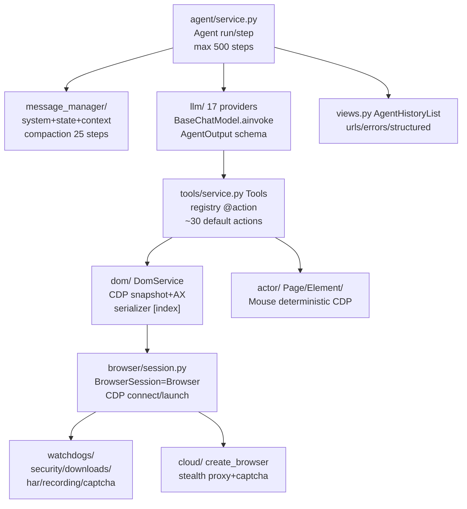

# browser-use — Phân tích chi tiết

> The open-source browser agent. Run it locally with any LLM, or on Browser Use Cloud.

> Phương pháp: 5 subagent đọc song song 5 cụm, mỗi file đọc 100% số dòng, mọi nhận định kèm trích dẫn `file + #L`.
> Nguồn: `D:\repos\browser-use` (PyPI `browser-use` v0.13.14, MIT, Python >=3.11). Quy mô: 556 file, trong đó 418 `.py` + 62 `.md`.
> Coverage: agent (~20 file, ~7.3k dòng) + browser/session (~28 file, ~10k dòng) + tools/dom/actor (~30 file, ~10k dòng) + llm/tokens/telemetry/sync/sandbox (~50 file) + packaging/examples/tests — đã đọc runtime 100%.

- **Bản chất:** Thư viện Python cho AI agent tự duyệt web: nhận task → Chromium qua CDP → đọc DOM → hỏi LLM chọn action → lặp lại tới `done`.
- **Không phải:** Không phải desktop-automation (dùng agent-desktop), không nhúng LLM, model thay được qua `BaseChatModel`.
- **Triết lý (AGENTS.md):** Pydantic v2 cho mọi action schema, `ActionResult` có structured content, mặc định khuyên `ChatBrowserUse`, cloud browser qua `use_cloud=True`.

## 0. Sơ đồ luồng tổng thể (Mermaid)

Luồng lệnh: `Agent(task, llm, browser)` → `browser.start()` (local launch hoặc cloud CDP) → loop `prepare_context → LLM → multi_act → history` → `done` → optional `gif/judge/telemetry`.

## 1. Cụm AGENT (`agent/`, 20 file, ~7.3k dòng)

- `service.py` (3544 dòng): `Agent` + vòng `run(max_steps=500)` [service.py](file:///D:/repos/browser-use/browser_use/agent/service.py#L2519-L2523), loop `while n_steps <= max_steps` [service.py](file:///D:/repos/browser-use/browser_use/agent/service.py#L2620-L2620), guard `consecutive_failures >= max_failures + int(final_response_after_failure)` break [service.py](file:///D:/repos/browser-use/browser_use/agent/service.py#L2630-L2635).
- `step()` 3 phase: `_prepare_context → _get_next_action → _execute_actions → _post_process → _finalize` [service.py](file:///D:/repos/browser-use/browser_use/agent/service.py#L1034-L1086).
- `_prepare_context`: `get_browser_state_summary(include_screenshot)` [service.py](file:///D:/repos/browser-use/browser_use/agent/service.py#L1097-L1097), `_update_action_models_for_page` + `get_prompt_description(url)` lọc action theo domain [service.py](file:///D:/repos/browser-use/browser_use/agent/service.py#L1114-L1117), inject `budget_warning(>=75%)`, `replan_nudge`, `exploration_nudge`, `loop_detector`, `force_done_last_step/after_failure`.
- `_get_model_output_with_retry`: gọi `llm.ainvoke(messages, output_format=AgentOutput)` [service.py](file:///D:/repos/browser-use/browser_use/agent/service.py#L1953-L1953), cắt `action[:max_actions_per_step]` (default 3) [service.py](file:///D:/repos/browser-use/browser_use/agent/service.py#L1961-L1962), action rỗng thì gửi `UserMessage('You forgot to return an action...')` retry 1 lần rồi chèn `done(success=False)` [service.py](file:///D:/repos/browser-use/browser_use/agent/service.py#L1668-L1702). `ValidationError` raise thô; `RateLimit/ProviderError` thử `_try_switch_to_fallback_llm` 1 lần với status `{401,402,429,500,502,503,504}` [service.py](file:///D:/repos/browser-use/browser_use/agent/service.py#L1973-L2023).
- `multi_act()` dispatch [service.py](file:///D:/repos/browser-use/browser_use/agent/service.py#L2755-L2873): cấm `done` đi kèm action khác [service.py](file:///D:/repos/browser-use/browser_use/agent/service.py#L2786-L2790), gọi `tools.act(...)` từng action [service.py](file:///D:/repos/browser-use/browser_use/agent/service.py#L2807-L2815), guard dừng khi (1) `terminates_sequence` (navigate/search/go_back/switch) hoặc (2) `post_url != pre_url`/focus đổi [service.py](file:///D:/repos/browser-use/browser_use/agent/service.py#L2837-L2853). Exception trong action → `ActionResult(error)` không raise tiếp.
- `views.py` (809 dòng): `AgentBrain{thinking,evaluation_previous_goal,memory,next_goal}` [views.py](file:///D:/repos/browser-use/browser_use/agent/views.py#L381-L385); `AgentOutput{... action: list[ActionModel] min 1}` + 3 factory `type_with_custom_actions / ..._no_thinking / ..._flash_mode` (flash chỉ giữ `[memory,action]`) [views.py](file:///D:/repos/browser-use/browser_use/agent/views.py#L388-L485); `ActionResult{is_done,success,error,attachments,images,long_term_memory,extracted_content,metadata}` + validator `success=True ⇒ is_done=True` [views.py](file:///D:/repos/browser-use/browser_use/agent/views.py#L307-L349); `AgentHistoryList` helpers `final_result/is_done/urls/errors/model_actions/structured_output` [views.py](file:///D:/repos/browser-use/browser_use/agent/views.py#L590-L943).
- `message_manager/service.py` (506 dòng): `History = [system, state, *context]` [message_manager/views.py](file:///D:/repos/browser-use/browser_use/agent/message_manager/views.py#L74-L83); `use_vision True` luôn screenshot, `'auto'` chỉ khi action yêu cầu, `False` tắt [message_manager/service.py](file:///D:/repos/browser-use/browser_use/browser_use/agent/message_manager/service.py#L461-L472); `_filter_sensitive_data` redact mọi value trong `sensitive_data` khỏi state_message; compaction mỗi 25 steps khi >40k chars, giữ `history[0]+6 items cuối`.
- `prompts.py` (505 dòng) + `system_prompts/*.md` (8 file): template full/no-thinking/flash/anthropic/browser-use riêng.
- Cơ chế dừng: `max_steps` (run param, default 500); step cuối ép `DoneAgentOutput` + message chỉ còn done-tool; `max_failures=5` chỉ `+=1` khi step 1-action lỗi (multi-action nhường loop-detector); `step_timeout=180s/llm_timeout(auto 30-90s)`; `final_response_after_failure=True` cho 1 LLM call vớt KQ cuối.
- Phụ trợ: `gif.py` (362 dòng) render history GIF; `cloud_events.py` (251 dòng) 5 event bubus `CreateAgentSession/Task/Step/OutputFile/UpdateTask`; `judge.py` chấm trace sau `done` (không override success); `variable_detector.py` cho `rerun_history`.

## 2. Cụm BROWSER (`browser/`, 28 file, ~10k dòng)

- `session.py` (3540 dòng): `class BrowserSession` [session.py](file:///D:/repos/browser-use/browser_use/browser/session.py#L183-L337); alias `Browser = BrowserSession` nằm ở package gốc `browser_use/__init__.py#L52`, không trong cụm browser.
- `connect(cdp_url)` [session.py](file:///D:/repos/browser-use/browser_use/browser/session.py#L1857-L1865): `http(s)` → GET `/json/version` lấy `webSocketDebuggerUrl` (localhost bypass proxy env), tạo `TimeoutWrappedCDPClient(max_ws 200MB)`, `Target.setAutoAttach(flatten=True)`, redirect `chrome://newtab` → `about:blank`, tạo target nếu trống, `_setup_proxy_auth + _attach_ws_drop_callback`. Fail → `RuntimeError(Failed to establish CDP connection)`.
- `start()` dispatch `BrowserStartEvent` → attach watchdogs → cloud (`create_browser`) hoặc local (`BrowserLaunchEvent → LocalBrowserWatchdog → BrowserLaunchResult(cdp_url)`) [session.py](file:///D:/repos/browser-use/browser_use/browser/session.py#L734-L843). `reconnect()` + `_auto_reconnect(3 lần, delays 1/2/4s)` khi WS rớt.
- Launch local (`profile.py` 1086 dòng + `watchdogs/local_browser_watchdog.py` 452 dòng): `CHROME_DEBUG_PORT=9242` tránh đụng 9222 [profile.py](file:///D:/repos/browser-use/browser_use/browser/profile.py#L36-L36); `CHROME_DISABLED_COMPONENTS` chứa `AutomationControlled` = stealth cơ bản [profile.py](file:///D:/repos/browser-use/browser_use/browser/profile.py#L45-L94); `CHROME_DEFAULT_ARGS` ~68 flags (`--disable-blink-features=AutomationControlled`, `--disable-ipc-flooding-protection` cho CDP tight-loop...) [profile.py](file:///D:/repos/browser-use/browser_use/browser/profile.py#L162-L230). Ưu tiên `executable_path` custom, fallback tìm browser hệ thống (`chrome.py`), cuối cùng `_install_browser_with_playwright()`; retry 3 lần khi lỗi SingletonLock.
- Proxy (`profile.py#L569-611` + `session.py#L2046-2129`): `ProxySettings(server,bypass,username,password)` → args `--proxy-server/--proxy-bypass-list` + CDP `Fetch.enable(handleAuthRequests)` trả `ProvideCredentials` khi `challenge.source==proxy`.
- Allowed/prohibited domains (`profile.py#L628-635`, `watchdogs/security_watchdog.py` 249 dòng): `allowed_domains` ưu tiên hơn `prohibited`; list ≥100 auto thành `set` (mất pattern-matching, warn); `about:blank/data:/blob:` luôn allow; `block_ip_addresses` chặn IP literal; vi phạm → `BrowserError(NavigationBlocked)` + đóng tab + về `about:blank`.
- Profile sync: `user_data_dir + profile_directory='Default'`; Chrome thật thì `_copy_profile()` vào temp (bỏ lock files, lỗi `WinError 32` thân thiện); `storage_state` (file/dict) overwrite cookies trong user_data_dir (có warn xung đột); `StorageStateWatchdog` + `export_storage_state()` convert CDP → Playwright JSON.
- Cloud (`cloud/` 2 file + `profile.py#L611-623`): `use_cloud` alias `cloud_browser`; `CreateBrowserRequest(profile_id→cloud_profile_id, proxy_country_code us/uk/fr/it/jp/au/de/fi/ca/in, timeout free 15 / paid 240 phút)`; POST cloud lấy `cdpUrl/liveUrl`, fail-fast khi thiếu API key. `CaptchaWatchdog` chỉ active khi `captcha_solver=True`.
- Record: `record_video_dir + VideoRecorderService` (screencast PNG → mp4, cần extra `video`); `record_har_path` (`HarRecordingWatchdog` 690 dòng, chỉ record `https://`, tôn trọng `omit/embed/attach + full/minimal`); `traces_dir` chỉ là placeholder config, chưa có watchdog thực thi.

## 3. Cụm TOOLS / DOM / ACTOR (~30 file, ~10k dòng)

- `tools/registry/service.py` (528 dòng): `Registry(exclude_actions)`; decorator `@action(description, param_model, domains/allowed_domains, terminates_sequence)` — truyền cả 2 alias domain → `ValueError`, tên trong blacklist thì skip đăng ký; cấm `**kwargs`; tách `action_params` vs `special_params` (tên `browser_session: BrowserSession`, `page_extraction_llm`, `file_system`...); `execute_action` validate `param_model(**params)`, thay sensitive `<secret>`, inject `page_url/cdp_client`, `BrowserError` có long_term_memory thì re-raise để `Tools.act` format; `create_action_model(include_actions, page_url)` lọc domain + bọc `RootModel[Union[...]]` tên `ActionModel`.
- `tools/service.py` (~2327 dòng): `Tools(exclude_actions, output_model)`; ~30 default tools đều `domains=None` (available mọi URL, giới hạn chỉ khi custom tool truyền); `terminates_sequence=True`: search/navigate/go_back/switch/evaluate; `Tools.act` bọc `wait_for(execute_action, timeout)` default `BROWSER_USE_ACTION_TIMEOUT_S` fallback 180s, timeout → `ActionResult(error=dead CDP)`, `str→extracted_content, None→ActionResult()`.
- Schema từng action (`tools/views.py` 152 dòng): `search{query,engine duckduckgo/google/bing}`, `navigate{url,new_tab}`, `wait{seconds clamp 0-30}`, `click{index≥1 (+coordinate khi bật)}`, `input{index,text,clear}`, `upload_file{index,path}` (check `available_file_paths`, chống traversal GHSA), `switch/close{tab_id 4-char}`, `extract{query,extract_links/images,start_from_char,output_schema ẩn,already_collected}`, `scroll{down,pages,index}`, `send_keys{keys}`, `screenshot{file_name?}` (có file → attachments, không → `metadata.include_screenshot`), `save_as_pdf`, `dropdown_options/select_dropdown`, `write/read/replace_file`, `evaluate{code}` (bắt buộc IIFE+try-catch, cắt 20k chars, auto-fix quotes), `done{text,success}` + `StructuredOutputAction[T]{success,data}` (ẩn internal fields khỏi schema).
- `dom/service.py` (1056 dòng) `DomService`: song song `snapshot(computedStyles+paintOrder+DOMRects)` + `DOM.getDocument(pierce)` + `AX full-tree mọi frame` (timeout 10s retry 2s, AX fail vẫn giữ snapshot+DOM); phát hiện JS listener batch 20 cap 100 element; merge AX theo `backendNodeId`, live `input_value/checked`, cộng dồn offset iframe, cross-origin iframe chặn depth/size≥10px; `is_element_visible_according_to_all_parents` check display/visibility/opacity/bounds + viewport.
- `dom/serializer/serializer.py` (1210 dòng): pipeline `simplified → paint-order → optimize → bbox-filter → assign [index]`; bỏ `style/script/head/meta`, SVG con, `data-browser-use-exclude`; scroll container chỉ index khi không con interactive; format LLM `*[index]<tag />` + `|scroll|IFRAME|SHADOW|` + compound (range/number/file/select/details/audio/video). `index = backend_node_id` (trừ va chạm synthetic).
- `clickable_elements.py is_interactive()`: JS-listener → True; iframe>100px; label/span bọc input; class/id search; AX focusable/editable/... (disabled/hidden → False); tag button/input/select/textarea/a/details...; role button/link/menuitem/checkbox...; icon 10-50px; `cursor:pointer`.
- `paint_order.py` (180 dòng, cap 5000 rects): duyệt paint-order giảm dần phủ RectUnion theo `(session,frame)`, bỏ nền trong suốt/opacity<0.8; `enhanced_snapshot.py` loại password/file/hidden + `autocomplete cc-/one-time-code` khỏi LLM/log (chống leak secret/OTP); `markdown_extractor.py` (466 dòng) HTML → markdownify → chunk 100k atomic theo header/table/list/code-fence overlap 5 dòng cho `extract`.
- `actor/` (Page 456 + Element 955 + Mouse 160 + Utils 162 dòng): API deterministic cho custom tool — `Page.evaluate/goto/screenshot/press/extract_content`, `Element.click(scrollIntoView→quads→CDP mouse→JS fallback)/fill/drag/select/drag_to`, `Mouse.click/down/up/move/scroll` (scroll tôn trọng `0` vs `None`), `Utils.get_key_info` map phím → `(code,vk)`. Cầu nối: `browser_session` inject theo tên (`SpecialActionParameters`).

## 4. Cụm LLM + HẠ TẦNG (~50 file)

- Contract duy nhất `BaseChatModel.ainvoke(messages, output_format)` [base.py](file:///D:/repos/browser-use/browser_use/llm/base.py#L50-L59); input chuẩn `User/System/AssistantMessage` (text/image/refusal+tool_calls), output `ChatInvokeCompletion(completion, usage, thinking...)`. 17 providers: openai (+like/azure), anthropic, google, browser_use, deepseek, groq, mistral, cerebras, openrouter, orcarouter, vercel, litellm, ollama, aws (bedrock/anthropic), oci_raw. Structured-output qua `SchemaOptimizer.create_optimized_json_schema` (flatten `$ref`, `additionalProperties:false`, ép required; Gemini/Mistral bản rút gọn riêng).
- Retry/timeout: OpenAI `max_retries=5`, Groq/OpenRouter/Orca `10`, Anthropic/Bedrock-Anthropic `10`, Google tự retry 5 lần mã `{429,500,502,503,504}` backoff `min(base*2^n,max)+jitter`, ChatBrowserUse `timeout=120s max_retries=5` retry `{429,500,502,503,504}+Timeout/Connect`, OCI `NoneRetryStrategy` = không retry SDK.
- Token/cost (`tokens/` 4 file + tests): mỗi provider tự bóc usage (Anthropic tách cache 5m/1h + geo ×1.1, Google cộng thoughts/image tokens); `TokenCost.register_llm` bọc `tracked_ainvoke`, `calculate_cost` trừ cached, nguồn giá ưu tiên `CUSTOM_MODEL_PRICING` (bu-2-0 $0.60/$3.50, mini $0.15/$1.50...) → LiteLLM GitHub cache 1 ngày → OpenRouter cache 1h; bật bằng `include_cost` hoặc `BROWSER_USE_CALCULATE_COST=true`.
- Telemetry (`telemetry/` + `config.py#L205`): mặc định `ANONYMIZED_TELEMETRY=true`, tắt bằng env false; `ProductTelemetry` singleton gửi PostHog eu, `capture()` no-op khi tắt; `BROWSER_USE_CLOUD_SYNC` mặc định theo telemetry, fail-silently.
- Logging (`logging_config.py` 274 dòng): level `RESULT=35`, format `[name] msg`, silence httpx/openai/anthropic... về ERROR; per-model logger (Google log 🚀/✅/⚠️/💥 kèm elapsed); `observability.py` decorator `observe` bọc lmnr, thiếu lib → no-op.

## 5. Packaging / Deploy / Examples / Tests

- `pyproject.toml` (248 dòng): `version=0.13.14` (lệch `server.json#10` ghi 0.13.11), `requires-python>=3.11,<4`, ~39 deps pin (`aiohttp 3.14.5, bubus 1.5.6, pydantic 2.13.5, cdp-use 1.4.5, browser-use-sdk 3-4, browser-harness 0.13.13, mcp 2.1.1`); extras `core/video/aws/oci/examples/eval/all`; 4 entry CLI cùng `browser_use.cli:main` (`browser-use/browseruse/bu/browser`); build hatchling chỉ đóng gói `browser_use/**/*.py + prompts md + skills md + dom js`; pytest `timeout=300, asyncio auto, testpaths tests, xdist loadscope`, **không config coverage**.
- Cài đặt: user `uv pip install browser-use` + `uvx browser-use install` (chạy `uvx playwright install chromium`, Linux thêm `--with-deps`); dev `uv sync --all-extras --dev`; `./bin/setup.sh|lint.sh|test.sh` (lint 4 job song song ruff+pyright+pre-commit; test chỉ `tests/ci`).
- `Dockerfile` (213) vs `Dockerfile.fast` (31): base python:3.12-slim, non-root `browseruse`, chromium + fonts, 2-stage `uv sync`, `EXPOSE 9242 9222`, `ENTRYPOINT browser-use`; bản fast dùng base-image cache, rebuild code ~16s.
- `@sandbox` (`sandbox/sandbox.py` 555 dòng): hàm decorated **phải có param đầu `browser: Browser`** (validate annotate, thiếu → TypeError); đóng gói source bỏ decorator + `cloudpickle` params base64, POST `sandbox.api.browser-use.com/sandbox-stream` header `X-API-Key`, SSE xử lý `BROWSER_CREATED→live_url / LOG / INSTANCE_READY / RESULT / ERROR`; parse KQ hỗ trợ Union/Pydantic/dataclass/`AgentHistoryList[T]`. Ví dụ `examples/sandbox/example.py + structured_output.py`.
- Profile-sync: cookie local → cloud qua skill `browser_use/skills/browser-use/SKILL.md` + `profile-sync.md` ngoài (browser-harness): `browser-use auth login` → mở browser login lấy `profile_id` → `@sandbox(cloud_profile_id=...)`.
- `skills/` 6 thư mục repo (browser-use/cloud/open-source/qa/remote-browser/x402) + skill runtime trong lib; `server.json` MCP registry (pypi `uvx --cli-mcp` stdio + remote `api.browser-use.com/v3/mcp` header `X-Browser-Use-API-Key`).
- `examples/` 113 `.py` (getting_started 01-05, browser/cloud/playwright/parallel, models ~20 provider, use-cases shopping/captcha/apply_to_job, integrations); `tests/`: `ci/` 66 file là suite chuẩn (`conftest` 238 dòng: autouse cô lập env + `create_mock_llm` **chỉ mock LLM không mock browser/DOM** + `browser_session` thật headless + `cloud_sync` cấm URL remote thật).

## 6. Rủi ro / điểm cần lưu ý

1. **Version skew**: `pyproject 0.13.14` vs `server.json 0.13.11` — MCP registry có thể trỏ bản cũ.
2. **Không coverage gate**: pytest không fail-under, `tests/ci` pass không đảm bảo hành vi browser thật (mock LLM + browser thật headless, cấm URL remote).
3. **Multi-act break 2 lớp**: `terminates_sequence` + runtime URL/focus đổi — thêm action điều hướng mà quên flag sẽ chạy lố sau khi trang đổi.
4. **`sensitive_data` chỉ redact theo value**: key mới/thiếu trong dict là lộ vào prompt/log; `enhanced_snapshot` đã chặn password/OTP nhưng field secret lạ vẫn lọt nếu DOM không đánh dấu.
5. **Domain filter fail-closed `about:blank`**: custom tool có `allowed_domains` sẽ ẩn khỏi system prompt khi chưa có URL — dễ tưởng tool mất.
6. **SSRF/upload**: `upload_file` đã chống traversal (GHSA) nhưng `navigate/search` + `evaluate` JS tùy ý — chỉ an toàn khi `allowed/prohibited_domains` bật; `evaluate` auto-fix quotes có thể sửa sai selector.
7. **Cloud multi-tenant**: `cloud_profile_id` + proxy country là PII/auth — lộ key là mất profile; `traces_dir` chưa có watchdog nên bật config cũng không ghi trace.
8. **OCI không retry, Google retry tay**: hành vi timeout khác nhau giữa provider — đổi model có thể đổi độ ổn định mà không rõ.
9. **Timeout 180s/action + step 180s + LLM 30-90s**: máy chậm + snapshot nặng có thể đói deadline dispatch (tương tự agent-desktop).

## Dùng cho JARVIS

- **Khung agent web hoàn chỉnh**: `Agent(task, llm, browser)` + tool registry + DOM serializer `[index]` + multi-act guard là mẫu tốt nhất để JARVIS thao tác web có kiểm chứng (mỗi step có screenshot/DOM/history).
- Route khuyến nghị: local `Browser(headless)` cho dev → `use_cloud=True` / `@sandbox(cloud_profile_id, proxy_country_code)` cho production (stealth + captcha + geo); cookie auth qua profile-sync, secret qua `sensitive_data` + `allowed_domains`.
- Kết hợp nguồn: agent-reach/tiktok-api (thu thập) → browser-use (verify tương tác + extract structured via `output_model_schema`) → trend-opportunity-radar (phân tích evidence).
- Lưu ý production: bật `ANONYMIZED_TELEMETRY=false` nếu cần riêng tư, pin `ChatBrowserUse` (nhanh/rẻ/chính xác cho automation), `record_video_dir/record_har_path` để audit, `generate_gif` để review.
